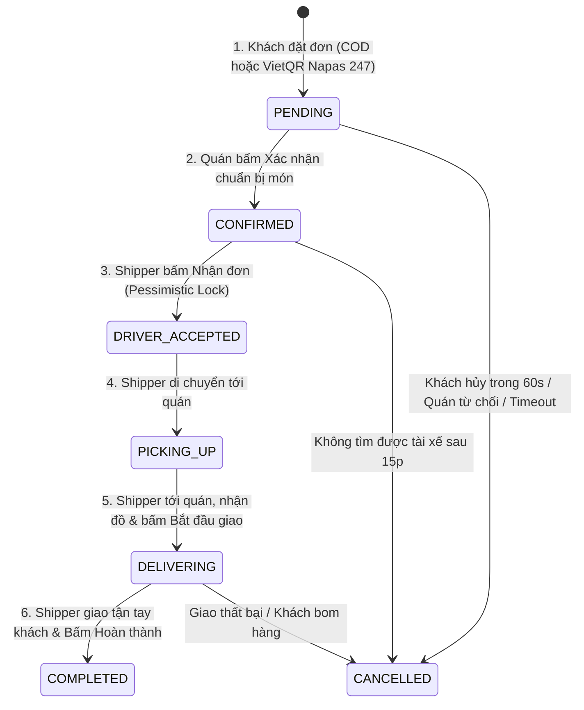

# 📘 QUY CHUẨN API ENDPOINTS, ORDER WORKFLOW & BẢN ĐỒ THAM CHIẾU MONOLITH (OLDER)

Tài liệu này chuẩn hóa 3 trụ cột kỹ thuật then chốt cho toàn bộ AI Agents và Kỹ sư phát triển hệ thống **Food Thunder Deli**:
1. **API Endpoints Matrix & Gateway Routing:** Bản đồ toàn bộ API, Gateway filter, và đồng bộ Frontend.
2. **Order Lifecycle & State Machine Workflow:** Quy trình chuyển trạng thái đơn hàng và phân quyền RBAC.
3. **Monolith Cross-Reference (`older/grab-food-springboot`):** Quy tắc đối chiếu bắt buộc với dự án gốc và chuẩn tương thích kép (Dual Compatibility).

---

## 🌐 1. BẢN ĐỒ API ENDPOINTS & QUY TẮC ĐỒNG BỘ GATEWAY

### 1.1. Nguyên tắc cốt lõi:
- **Base URL:** Client luôn gọi qua API Gateway tại `http://localhost:8080/api/v1/...`.
- **Public GET Whitelist (`PUBLIC_GET_PATTERNS`):** Trong `api-gateway/src/main/java/com/foodthunder/gateway/filter/JwtAuthenticationFilter.java`, các đường dẫn sau bắt buộc phải có trong `PUBLIC_GET_PATTERNS` để khách vãng lai và người dùng chưa đăng nhập không bị chặn `401 Unauthorized`:
  - `/api/v1/restaurants/**`, `/api/v1/shops/**`
  - `/api/v1/categories/**`
  - `/api/v1/products/**`, `/api/v1/foods/**`
  - `/api/v1/toppings/**`
  - `/api/v1/vouchers/**`
  - `/api/v1/addresses/suggest`, `/api/v1/addresses/detail/**`, `/api/v1/addresses/reverse`
- **Gateway Route Predicates:** Trong `api-gateway/src/main/resources/application.yml`, **tuyệt đối không để khoảng trắng sau dấu phẩy** trong predicate `Path=...` (ví dụ: `Path=/api/v1/restaurants/**,/api/v1/toppings/**`).
- **Single Source of Truth Frontend:** Tất cả endpoint phải được khai báo trong `food-deli-client/src/services/api/endpoints.ts`.

### 1.2. Ma trận API Endpoints theo Service

| Service | Nhóm chức năng | Endpoint chuẩn Microservice | Endpoint tương thích Monolith (Older) | Quyền truy cập |
| :--- | :--- | :--- | :--- | :--- |
| **`auth-service`** | Đăng nhập / Đăng ký | `POST /api/v1/auth/login` `POST /api/v1/auth/register` | `POST /api/auth/login` `POST /api/auth/register` | Public (Ẩn danh) |
| | Hồ sơ & Sổ địa chỉ | `GET /api/v1/users/me` `GET /api/v1/users/addresses` | `GET /api/users/me` `GET /api/addresses` | Authenticated |
| **`restaurant-service`** | Danh sách & Chi tiết quán | `GET /api/v1/restaurants` `GET /api/v1/restaurants/{id}` | `GET /api/restaurants` `GET /api/restaurants/{id}` | Public GET |
| | Món ăn của quán | `GET /api/v1/restaurants/{id}/products` | `GET /api/restaurants/{id}/foods` | Public GET |
| | Topping của quán | `GET /api/v1/toppings?restaurantId={id}` | `GET /api/v1/restaurants/{id}/toppings` | Public GET |
| | Nhóm Topping | `GET /api/v1/toppings/groups?restaurantId={id}` | `GET /api/restaurants/{id}/toppings` | Public GET |
| | Topping theo món | `GET /api/v1/products/{id}/toppings` | `GET /api/foods/{id}/toppings` | Public GET |
| | Quản lý Topping (CRUD) | `POST /api/v1/toppings` `PUT /api/v1/toppings/{id}` `PATCH /api/v1/toppings/{id}/status` `DELETE /api/v1/toppings/{id}` | `POST /api/restaurants/{id}/toppings` `PUT /api/toppings/{id}` `DELETE /api/toppings/{id}` | `ROLE_MERCHANT` |
| | Gán topping cho món | `POST /api/v1/products/{id}/toppings` | `POST /api/foods/{id}/toppings` | `ROLE_MERCHANT` |
| | Quán của tôi (Multi-shops) | `GET /api/v1/restaurants/mine` | `GET /api/restaurants/mine` | `ROLE_MERCHANT` |
| **`order-service`** | Tạo đơn & Danh sách đơn | `POST /api/v1/orders` `GET /api/v1/orders` | `POST /api/orders` `GET /api/orders` | Authenticated |
| | Chi tiết & Hủy đơn | `GET /api/v1/orders/{id}` `POST /api/v1/orders/{id}/cancel` | `GET /api/orders/{id}` `POST /api/orders/{id}/cancel` | Owner / Admin |
| **`delivery-service`** | Nhận cuốc & Điều phối | `POST /api/v1/deliveries/orders/{id}/accept` | `POST /api/driver/orders/{id}/accept` | `ROLE_DRIVER` |
| | Cập nhật tiến trình giao | `PATCH /api/v1/deliveries/orders/{id}/status` | `PATCH /api/driver/orders/{id}/status` | `ROLE_DRIVER` |
| **`payment-service`** | VietQR SePay & COD | `POST /api/v1/payments/sepay/generate` `POST /api/v1/payments/sepay/webhook` | `POST /api/payments/...` | Authenticated / Webhook |
| **`review-service`** | Đánh giá Quán & Món ăn riêng | `POST /api/v1/reviews/restaurant` | `POST /api/reviews/restaurant` | `ROLE_CUSTOMER` |
| | Đánh giá Tài xế riêng (Quick tags) | `POST /api/v1/reviews/driver` | `POST /api/reviews/driver` | `ROLE_CUSTOMER` |
| | Kiểm tra trạng thái đánh giá đơn (24h) | `GET /api/v1/reviews/orders/{id}/status` | Status Check | `ROLE_CUSTOMER` |
| | Đánh giá tổng hợp (Legacy/Combined) | `POST /api/v1/reviews` `GET /api/v1/reviews/orders/{id}/eligibility` | `POST /api/reviews` | `ROLE_CUSTOMER` |
| | Xem review quán ăn & Thống kê | `GET /api/v1/reviews/restaurants/{id}` `GET /api/v1/reviews/restaurants/{id}/summary` | `GET /api/reviews/restaurants/{id}` | Public GET |
| | Quản lý đánh giá quán (Lọc món) | `GET /api/v1/reviews/merchant/mine` | Read-only | `ROLE_MERCHANT` |
| | Xem đánh giá tài xế (Lọc ngày) | `GET /api/v1/reviews/driver/mine` `GET /api/v1/reviews/driver/summary` | Read-only | `ROLE_DRIVER` |
| | Quản trị đánh giá hệ thống (CRD) | `GET /api/v1/reviews/admin` `GET /api/v1/reviews/admin/{id}` `POST /api/v1/reviews/admin` `DELETE /api/v1/reviews/admin/{id}` | Admin CRD | `ROLE_ADMIN` |

---

## 📦 2. ORDER STATUS STATE MACHINE WORKFLOW

### Phân quyền trạng thái nghiêm ngặt (State Guards):
1. **`PENDING` $\rightarrow$ `CONFIRMED`:** **Chỉ dành riêng cho Chủ quán (`ROLE_MERCHANT`)**. Quán **tuyệt đối không được phép** bấm chuyển đơn sang `COMPLETED`.
2. **`DELIVERING` $\rightarrow$ `COMPLETED`:** **Chỉ dành riêng cho Tài xế (`ROLE_DRIVER`)**. Sau khi khách nhận đồ ăn và thu đủ tiền COD (nếu có), tài xế bấm "Giao thành công" để chốt đơn.
3. **Mở khóa Đánh giá 5★:** Ngay khi đơn chuyển `COMPLETED`, hệ thống cho phép khách hàng đánh giá món ăn và dịch vụ giao hàng, đồng thời cộng tiền vào ví quán và ví tài xế.

---

## 🏛️ 3. BẢN ĐỒ THAM CHIẾU VỚI MONOLITH CŨ (`older/grab-food-springboot`)

Khi thiết kế, refactor hoặc sửa lỗi ở bất kỳ service nào, AI Agent **bắt buộc đối chiếu với mã nguồn gốc tại `older/`**:

### 3.1. Vị trí thư mục gốc Monolith:
`d:\ojt-food-deli-start\older\grab-food-springboot/`

### 3.2. Bảng ánh xạ các thành phần cốt lõi:

| Phân hệ Microservice mới | File Controller / Service mới | File tương ứng trong Monolith cũ (`older/`) | Lưu ý đối chiếu & Kế thừa |
| :--- | :--- | :--- | :--- |
| **`restaurant-service`** | `ToppingController.java` `ToppingServiceImpl.java` | `com.grabfood.controller.ToppingController` `com.grabfood.service.impl.ToppingServiceImpl` | Hỗ trợ cả 2 endpoint: `GET /toppings?restaurantId=...` VÀ `GET /restaurants/{id}/toppings`. Đồng bộ cột `group_name` trong DB. |
| | `RestaurantController.java` `RestaurantServiceImpl.java` | `com.grabfood.controller.RestaurantController` `com.grabfood.service.impl.RestaurantServiceImpl` | Kế thừa logic tính giờ mở/đóng cửa (`isOpenToday`), khoảng cách và rating trung bình. |
| | `ProductController.java` `ProductServiceImpl.java` | `com.grabfood.controller.FoodController` `com.grabfood.service.impl.FoodServiceImpl` | Kế thừa logic gán topping cho món (`AssignToFoodRequest` $\longleftrightarrow$ `AssignToppingsRequest`). |
| | `VoucherController.java` | `com.grabfood.controller.VoucherController` | Logic kiểm tra điều kiện áp dụng voucher (`minOrderAmount`, `maxDiscountAmount`). |
| **`order-service`** | `OrderController.java` `OrderServiceImpl.java` | `com.grabfood.controller.OrderController` `com.grabfood.service.impl.OrderServiceImpl` | Lưu ý Data Snapshot Pattern: Snapshot giá món ăn, tên món, địa chỉ giao hàng vào `order_items` và `orders`. Dùng Plain IDs thay vì `@ManyToOne`. |
| **`delivery-service`** | `DeliveryController.java` `DeliveryServiceImpl.java` | `com.grabfood.controller.DriverController` `com.grabfood.service.impl.DriverServiceImpl` | Kế thừa công thức tính hiệu suất nhận/hủy đơn (AR/CR rolling 100 orders) theo PRD. |
| **`payment-service`** | `PaymentController.java` `PaymentServiceImpl.java` | `com.grabfood.controller.PaymentController` | Nâng cấp từ VNPay sang VietQR (Napas 247) SePay động kèm Webhook đối soát số dư. |

### 3.3. Quy tắc kiểm tra tính toàn vẹn Schema (Schema Integrity Checklist):
- Khi định nghĩa `@Entity` trong Microservice, phải đối chiếu với cả:
  1. `older/grab-food-springboot/src/main/java/com/grabfood/entity/<Entity>.java`
  2. Lược đồ chính thức tại `database/seed_all.sql`
- Nếu Entity có trường mới (ví dụ `group_name` trong `Topping`), bắt buộc phải có lệnh `ALTER TABLE` tương ứng trong `database/seed_all.sql` để tránh lỗi Hibernate `BadSqlGrammarException (Unknown column)`.

