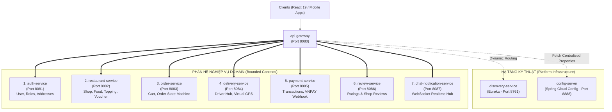

# 🏛️ TÀI LIỆU ĐẶC TẢ CẤU TRÚC KIẾN TRÚC MICROSERVICES (FOOD THUNDER DELI)

Tài liệu này chuẩn hóa toàn bộ cấu trúc hệ thống **Spring Boot Microservices** cho dự án **Food Thunder Deli**, được phân rã khoa học từ phiên bản nguyên khối [`older/grab-food-springboot`](file:///d:/ojt-food-deli-start/older/grab-food-springboot) và lược đồ cơ sở dữ liệu gồm 26 bảng tại [`database/seed_all.sql`](file:///d:/ojt-food-deli-start/database/seed_all.sql) theo phương pháp luận **Domain-Driven Design (DDD)**.

---

## 📑 MỤC LỤC
1. [Bộ Công Nghệ Cốt Lõi (Core Tech Stack)](#1-bộ-công-nghệ-cốt-lõi-core-tech-stack)
2. [Danh Mục 10 Microservices & Bounded Contexts](#2-danh-mục-10-microservices--bounded-contexts)
3. [Bảng Phân Bổ 26 Bảng Cơ Sở Dữ Liệu (Database Allocation Matrix)](#3-bảng-phân-bổ-26-bảng-cơ-sở-dữ-liệu-database-allocation-matrix)
4. [Cấu Trúc Thư Mục Chuẩn Từng Microservice (`src/`)](#4-cấu-trúc-thư-mục-chuẩn-từng-microservice-src)
5. [Ma Trận Giao Tiếp Liên Dịch Vụ (Inter-Service Communication)](#5-ma-trận-giao-tiếp-liên-dịch-vụ-inter-service-communication)
6. [Bản Đồ Định Tuyến API Gateway (Gateway Routing Matrix)](#6-bản-đồ-định-tuyến-api-gateway-gateway-routing-matrix)
7. [Quy Trình & Thứ Tự Khởi Chạy (Startup Sequence)](#7-quy-trình--thứ-tự-khởi-chạy-startup-sequence)

---

## 1. Bộ Công Nghệ Cốt Lõi (Core Tech Stack)

- **Ngôn ngữ:** Java 21 (LTS)
- **Framework nền tảng:** Spring Boot 3.3.5, Spring Cloud 2023.0.3
- **Thành phần hạ tầng Microservices:**
  - **API Gateway:** Spring Cloud Gateway (Reactive, Cân bằng tải động, Lọc JWT tập trung, CORS toàn cục)
  - **Service Registry:** Netflix Eureka Server (`discovery-service`)
  - **Config Server:** Spring Cloud Config Server (Centralized Git/Native Config)
  - **Giao tiếp đồng bộ:** Spring Cloud OpenFeign + Spring Cloud LoadBalancer
  - **Khả năng chịu lỗi:** Resilience4j (Circuit Breaker, TimeLimiter, FallbackFactory)
  - **Bảo mật:** Spring Security 6, JWT (Nimbus-JOSE / JJWT 0.12), BCrypt Password Encoder
  - **Giao tiếp bất đồng bộ & Realtime:** Spring WebSocket STOMP / SockJS, RabbitMQ / Apache Kafka
- **Lưu trữ dữ liệu & ORM:** Spring Data JPA, Hibernate ORM, MySQL 8.0, Redis Caching
- **Kiểm thử:** JUnit 5, Mockito, MockMvc, AssertJ

---

## 2. Danh Mục 10 Microservices & Bounded Contexts

Toàn bộ hệ thống được phân rã thành **3 Services Hạ tầng Kỹ thuật** và **7 Services Nghiệp vụ Domain**:



### Chi tiết vai trò từng Service:
1. **`discovery-service` (Port 8761):** Netflix Eureka Server quản lý định danh thực thể dịch vụ, theo dõi nhịp tim (heartbeat), phục vụ khám phá dịch vụ tự động.
2. **`config-server` (Port 8888):** Quản lý tập trung file cấu hình (`api-gateway.yml`, `application.yml`,...).
3. **`api-gateway` (Port 8080):** Điểm tiếp nhận request duy nhất của toàn hệ thống, xác thực chữ ký JWT, kiểm tra quyền truy cập theo đường dẫn, chuyển tiếp request tới các microservices qua giao thức cân bằng tải `lb://<service-name>`.
4. **`auth-service` (Port 8081):** Quản trị danh tính người dùng, phân quyền RBAC (ADMIN, MERCHANT, DRIVER/SHIPPER, CUSTOMER), sổ địa chỉ nhận hàng cá nhân, thông tin chi tiết merchant.
5. **`restaurant-service` (Port 8082):** Quản lý thông tin gian hàng quán ăn (Multi-shops), thực đơn, danh mục món ăn, nhóm món kèm/topping, mã giảm giá do quán phát hành.
6. **`order-service` (Port 8083):** Quản lý giỏ hàng (Cart), tạo đơn hàng (Checkout transaction), áp dụng voucher hợp lệ, máy trạng thái đơn hàng (Order State Machine), lịch sử thay đổi trạng thái đơn hàng.
7. **`delivery-service` (Port 8084):** Nền tảng điều phối tài xế: tiếp nhận hồ sơ đăng ký tài xế, bảng cấp phát đơn hàng (Order Feed), quy trình giao hàng ảo (Virtual Delivery Workflow: Nhận cuốc $\rightarrow$ Lấy món $\rightarrow$ Đang giao $\rightarrow$ Hoàn tất), mô phỏng GPS di chuyển, thống kê ví thu nhập.
8. **`payment-service` (Port 8085):** Quản lý thanh toán tiền mặt khi nhận hàng (COD), tạo URL thanh toán trực tuyến (VNPAY / MoMo / ZaloPay), tiếp nhận Webhook Callback, lưu vết lịch sử giao dịch thanh toán.
9. **`review-service` (Port 8086):** Tiếp nhận đánh giá sau khi hoàn tất đơn hàng (1 - 5 sao kèm hình ảnh/bình luận cho quán ăn và tài xế), tính toán điểm sao trung bình và số lượng đánh giá tích lũy.
10. **`chat-notification-service` (Port 8087):** Kênh nhắn tin trực tiếp Khách hàng - Chủ quán qua WebSocket (STOMP), phát chuông báo và đẩy sự kiện đơn hàng thời gian thực đến màn hình tài xế và quán ăn.

---

## 3. Bảng Phân Bổ 26 Bảng Cơ Sở Dữ Liệu (Database Allocation Matrix)

Toàn bộ 26 bảng trong file SQL gốc [`database/seed_all.sql`](file:///d:/ojt-food-deli-start/database/seed_all.sql) và các Entity từ [`older/grab-food-springboot`](file:///d:/ojt-food-deli-start/older/grab-food-springboot) được phân bổ nghiêm ngặt theo ranh giới Domain Bounded Context:

| Microservice | Bảng CSDL đảm nhận (`seed_all.sql`) | Entity JPA tương ứng trong `older/` | Controller tương ứng trong `older/` |
| :--- | :--- | :--- | :--- |
| **`auth-service`** | `roles`<br>`users`<br>`user_roles`<br>`user_addresses`<br>`merchant_details`<br>`system_settings` *(chia sẻ)* | `Role.java`<br>`User.java`<br>`UserAddress.java`<br>`MerchantDetail.java`<br>`SystemSetting.java` | `AuthController.java`<br>`UserController.java`<br>`AddressController.java`<br>`AdminController.java` *(phần settings)* |
| **`restaurant-service`** | `restaurants`<br>`restaurant_change_requests`<br>`categories`<br>`toppings`<br>`food_items`<br>`food_toppings`<br>`vouchers` | `Restaurant.java`<br>`RestaurantChangeRequest.java`<br>`Category.java`<br>`Topping.java`<br>`FoodItem.java`<br>`Voucher.java` | `RestaurantController.java`<br>`CategoryController.java`<br>`FoodController.java`<br>`ToppingController.java`<br>`VoucherController.java`<br>`AdminController.java` *(phần voucher)* |
| **`order-service`** | `orders`<br>`order_items`<br>`order_item_toppings`<br>`order_statuses`<br>`order_status_logs` | `Order.java`<br>`OrderItem.java`<br>`OrderItemTopping.java`<br>`OrderStatus.java`<br>`OrderStatusLog.java` | `OrderController.java` |
| **`delivery-service`** | `driver_details`<br>`driver_locations`<br>`driver_offers`<br>`driver_penalties` | `DriverDetail.java`<br>`DriverLocation.java`<br>`DriverOffer.java`<br>`DriverPenalty.java` | `DriverController.java`<br>`ApplicationController.java` |
| **`payment-service`** | `payments`<br>`payment_transactions` | `Payment.java`<br>`PaymentTransaction.java` | `PaymentController.java` |
| **`review-service`** | `reviews` | `Review.java` | `ReviewController.java` |
| **`chat-notification-service`** | `chat_messages` | `ChatMessage.java` | `ChatController.java` |

> ⚠️ **NGUYÊN TẮC LIÊN KẾT BẢNG GIỮA CÁC MICROSERVICES:**
> - Trong **cùng một service**: Giữ nguyên quan hệ JPA (`@ManyToOne`, `@OneToMany`, `@ManyToMany`) và Foreign Key vật lý (`ON DELETE CASCADE`). Ví dụ: `Order` $\leftrightarrow$ `OrderItem` $\leftrightarrow$ `OrderItemTopping`.
> - **Giữa các service khác nhau**: **TUYỆT ĐỐI KHÔNG** dùng `@ManyToOne`, `@JoinColumn` hay Foreign Key vật lý. Chỉ lưu **Plain ID** (`Long customerId`, `Long restaurantId`, `Long driverId`, `Long orderId`) kèm **INDEX B-Tree** (`KEY idx_...`). Dữ liệu chi tiết cần hiển thị sẽ được truy vấn động qua **Spring Cloud OpenFeign** hoặc mang theo trong Event.
> - Chi tiết phân rã và kịch bản SQL đã tách rời: xem tài liệu [`document/KIEN_TRUC_CSDL_LOGIC_MICROSERVICES.md`](file:///d:/ojt-food-deli-start/document/KIEN_TRUC_CSDL_LOGIC_MICROSERVICES.md) và file SQL [`database/schema_decoupled_microservices.sql`](file:///d:/ojt-food-deli-start/database/schema_decoupled_microservices.sql).

---

## 4. Cấu Trúc Thư Mục Chuẩn Từng Microservice (`src/`)

Mỗi module microservice con trong dự án (ví dụ `food-deli-service/order-service/`) phải tuân theo cấu trúc phân tầng sạch (Clean Layered Architecture):

```
<service-module>/
├── pom.xml
├── Dockerfile
├── src/
│   ├── main/
│   │   ├── java/com/foodthunder/<servicename>/
│   │   │   ├── <ServiceName>Application.java     # Class chứa hàm main và @EnableDiscoveryClient
│   │   │   │
│   │   │   ├── client/                          # Khai báo OpenFeign Clients gọi service khác
│   │   │   │   ├── RestaurantClient.java
│   │   │   │   ├── UserClient.java
│   │   │   │   └── fallback/                    # Resilience4j FallbackFactory xử lý khi service đối tác ngắt kết nối
│   │   │   │       ├── RestaurantClientFallbackFactory.java
│   │   │   │       └── UserClientFallbackFactory.java
│   │   │   │
│   │   │   ├── config/                          # Cấu hình Security, Feign Interceptor, RabbitMQ/WebSocket
│   │   │   │   ├── FeignClientInterceptor.java  # Tự động gắn Bearer Token qua request tiếp theo
│   │   │   │   └── SecurityConfig.java
│   │   │   │
│   │   │   ├── controller/                      # REST API Endpoints (/api/v1/...)
│   │   │   │
│   │   │   ├── dto/                             # Data Transfer Objects & Event Models
│   │   │   │   ├── request/                     # DTO đầu vào, có Jakarta Validation (@Valid, @NotNull)
│   │   │   │   ├── response/                    # DTO trả về đóng gói trong ApiResponse<T>
│   │   │   │   └── event/                       # Event Records phục vụ Message Broker
│   │   │   │
│   │   │   ├── entity/                          # JPA Entities thuộc quyền sở hữu của Domain này
│   │   │   │
│   │   │   ├── exception/                       # Custom Exceptions & Centralized @RestControllerAdvice
│   │   │   │   ├── ResourceNotFoundException.java
│   │   │   │   ├── BadRequestException.java
│   │   │   │   └── GlobalExceptionHandler.java
│   │   │   │
│   │   │   ├── repository/                      # Spring Data JPA Repositories
│   │   │   │
│   │   │   └── service/                         # Interfaces & Implementations chứa Transaction và Business logic
│   │   │       ├── <Domain>Service.java
│   │   │       └── impl/
│   │   │           └── <Domain>ServiceImpl.java
│   │   │
│   │   └── resources/
│   │       ├── application.yml                  # Cấu hình Eureka, Port, DataSource, Feign, CircuitBreaker
│   │       └── application-prod.yml
│   │
│   └── test/                                    # Unit & Integration tests (JUnit 5, Mockito, MockMvc)
```

---

## 5. Ma Trận Giao Tiếp Liên Dịch Vụ (Inter-Service Communication)

Khi phân rã microservice, các luồng nghiệp vụ cần phối hợp dữ liệu với nhau qua OpenFeign hoặc Event:

| Service Gọi | Service Nhận | Giao Thức | Mục Đích Nghiệp Vụ | Xử Lý Fallback (Resilience4j) |
| :--- | :--- | :---: | :--- | :--- |
| **`order-service`** | `restaurant-service` | OpenFeign (REST) | Kiểm tra món ăn có tồn tại, quán có đang mở cửa, kiểm tra voucher hợp lệ. | Báo lỗi 400 "Món ăn hoặc quán hiện không sẵn sàng phục vụ". |
| **`order-service`** | `auth-service` | OpenFeign (REST) | Lấy thông tin họ tên, số điện thoại, địa chỉ nhận hàng của khách. | Dùng snapshot địa chỉ đã lưu trong session. |
| **`order-service`** | `payment-service` | OpenFeign / Event | Khởi tạo giao dịch thanh toán khi khách checkout. | Chuyển phương thức sang COD tạm thời hoặc báo lỗi tạo phiên. |
| **`order-service`** | `chat-notification-service` | Event / REST | Bắn thông báo có đơn hàng mới cho Merchant & Tài xế. | Log cảnh báo, thử lại qua Message Queue (Retry). |
| **`delivery-service`**| `order-service` | OpenFeign (REST) | Cập nhật trạng thái đơn (Shipper đã nhận cuốc $\rightarrow$ Đã lấy hàng $\rightarrow$ Đã giao). | Thử lại theo Exponential Backoff. |
| **`delivery-service`**| `auth-service` | OpenFeign (REST) | Lấy thông tin bằng lái, phương tiện và tài khoản của tài xế. | Trả về thông tin cơ bản từ cache. |
| **`review-service`** | `order-service` | OpenFeign (REST) | Kiểm tra đơn hàng đã hoàn tất (DELIVERED) chưa trước khi cho phép gửi đánh giá. | Chặn gửi đánh giá với thông báo "Đơn hàng chưa hoàn thành". |

---

## 6. Bản Đồ Định Tuyến API Gateway (Gateway Routing Matrix)

API Gateway định tuyến tất cả các yêu cầu từ Web Frontend (`food-deli-client`) vào đúng microservice đích qua Service ID trên Eureka:

```yaml
spring:
  cloud:
    gateway:
      routes:
        # 1. Phân hệ Xác thực & Người dùng
        - id: auth-service-route
          uri: lb://auth-service
          predicates:
            - Path=/api/v1/auth/**, /api/v1/users/**, /api/v1/addresses/**

        # 2. Phân hệ Gian hàng & Ẩm thực
        - id: restaurant-service-route
          uri: lb://restaurant-service
          predicates:
            - Path=/api/v1/restaurants/**, /api/v1/shops/**, /api/v1/categories/**, /api/v1/products/**, /api/v1/toppings/**, /api/v1/vouchers/**

        # 3. Phân hệ Giỏ hàng & Đơn hàng
        - id: order-service-route
          uri: lb://order-service
          predicates:
            - Path=/api/v1/orders/**, /api/v1/cart/**

        # 4. Phân hệ Vận chuyển & Tài xế
        - id: delivery-service-route
          uri: lb://delivery-service
          predicates:
            - Path=/api/v1/deliveries/**, /api/v1/shippers/**, /api/v1/drivers/**

        # 5. Phân hệ Thanh toán
        - id: payment-service-route
          uri: lb://payment-service
          predicates:
            - Path=/api/v1/payments/**

        # 6. Phân hệ Đánh giá & Phản hồi
        - id: review-service-route
          uri: lb://review-service
          predicates:
            - Path=/api/v1/reviews/**

        # 7. Phân hệ Trò chuyện & WebSocket Realtime
        - id: chat-notification-service-route
          uri: lb://chat-notification-service
          predicates:
            - Path=/api/v1/chat/**, /ws/**
```

---

## 7. Quy Trình & Thứ Tự Khởi Chạy (Startup Sequence)

Do có sự phụ thuộc lẫn nhau giữa Eureka, Config Server và các Business Services, thứ tự khởi động chuẩn trên môi trường Docker / Local bắt buộc là:

1. **Bước 1: MySQL Database (Port 3306):** Khởi động trước, chờ nạp xong kịch bản dữ liệu `seed_all.sql`.
2. **Bước 2: `discovery-service` (Port 8761):** Khởi động để sẵn sàng nhận đăng ký từ các service.
3. **Bước 3: `config-server` (Port 8888):** Đăng ký vào Eureka và bắt đầu phân phát cấu hình.
4. **Bước 4: `api-gateway` (Port 8080):** Sẵn sàng tiếp nhận kết nối HTTP/WebSocket và ánh xạ danh sách route.
5. **Bước 5: Nhóm Business Services song song:**
   - `auth-service` (8081)
   - `restaurant-service` (8082)
   - `order-service` (8083)
   - `delivery-service` (8084)
   - `payment-service` (8085)
   - `review-service` (8086)
   - `chat-notification-service` (8087)
6. **Bước 6: Frontend Client:** `food-deli-client` (Port 80) kết nối thông qua API Gateway.

