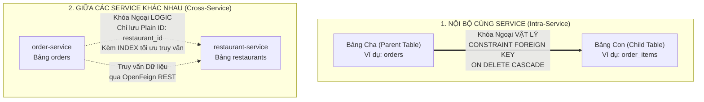
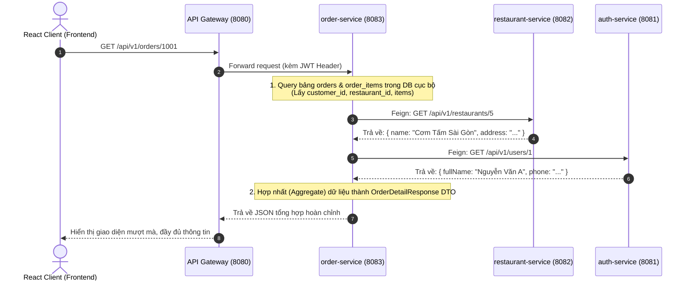

# 🏛️ ĐẶC TẢ KIẾN TRÚC CƠ SỞ DỮ LIỆU PHÂN TÁN & TÁCH LIÊN KẾT LOGIC (MICROSERVICES DATA DECOUPLING)
> **Dự án:** Food Thunder Deli (Spring Boot 3 Microservices Architecture)  
> **Áp dụng cho:** 10 Microservices & 26 Bảng CSDL từ [`database/seed_all.sql`](file:///d:/ojt-food-deli-start/database/seed_all.sql)  
> **Nguyên lý cốt lõi:** Domain-Driven Design (DDD) - Database per Service & Loose Coupling  

---

## 📑 MỤC LỤC
1. [Bối Cảnh & Vấn Đề Của Khóa Ngoại Vật Lý Trong Microservices](#1-bối-cảnh--vấn-đề-của-khóa-ngoại-vật-lý-trong-microservices)
2. [Quy Tắc Vàng: Khóa Ngoại Vật Lý vs Khóa Ngoại Logic](#2-quy-tắc-vàng-khóa-ngoại-vật-lý-vs-khóa-ngoại-logic)
3. [Bảng Ma Trận Phân Rã 26 Bảng Theo 7 Bounded Contexts](#3-bảng-ma-trận-phân-rã-26-bảng-theo-7-bounded-contexts)
4. [Chi Tiết Tách Khóa Ngoại Chéo (Cross-Service Decoupling)](#4-chi-tiết-tách-khóa-ngoại-chéo-cross-service-decoupling)
5. [Các Mẫu Thiết Kế Thay Thế Khóa Ngoại Vật Lý (Design Patterns)](#5-các-mẫu-thiết-kế-thay-thế-khóa-ngoại-vật-lý-design-patterns)
6. [Mô Hình Truy Vấn Dữ Liệu Không Cần Lệnh JOIN Chéo (API Orchestration)](#6-mô-hình-truy-vấn-dữ-liệu-không-cần-lệnh-join-chéo-api-orchestration)

---

## 1. Bối Cảnh & Vấn Đề Của Khóa Ngoại Vật Lý Trong Microservices

Trong kiến trúc Monolith truyền thống, toàn bộ 26 bảng nằm chung trong 1 cơ sở dữ liệu (`grabfood_db`) và sử dụng các câu lệnh ràng buộc khóa ngoại cứng (`CONSTRAINT FOREIGN KEY ... REFERENCES ... ON DELETE CASCADE`). 

Tuy nhiên, khi chuyển sang kiến trúc **Microservices**, việc giữ lại các khóa ngoại cứng liên kết chéo giữa các bảng sẽ gây ra **4 tử huyệt kiến trúc**:

1. ❌ **Không thể tách Cơ sở dữ liệu độc lập (Database per Service):** Nếu bảng `orders` bắt buộc phải trỏ Foreign Key vật lý sang bảng `restaurants` và `users`, chúng ta không bao giờ có thể tách thành `order_db`, `restaurant_db` hay `auth_db` trên các máy chủ CSDL khác nhau.
2. ❌ **Lỗi phụ thuộc tuần hoàn (Circular Dependency) & Khó Seeding:** Khi khởi tạo dữ liệu mẫu hoặc migrate cơ sở dữ liệu, việc các bảng chéo nhau đòi hỏi phải bật tắt `FOREIGN_KEY_CHECKS = 0`, rất dễ gây lỗi crash hệ thống khi deploy production.
3. ❌ **Xóa tầng bậc nguy hiểm (Cascading Failure):** Nếu bảng `users` thực hiện xóa một tài khoản bị cấm (`ON DELETE CASCADE`), hành vi này có thể tự động xóa luôn toàn bộ lịch sử đơn hàng trong `orders` hoặc review trong `reviews`, làm mất dữ liệu kiểm toán tài chính (Audit Log).
4. ❌ **Nghẽn cổ chai hiệu năng (Performance Bottleneck):** Khóa ngoại vật lý bắt buộc MySQL Engine phải đặt khóa kiểm tra (Shared Lock) trên bảng cha mỗi khi thêm/sửa bản ghi ở bảng con, gây nghẽn Transaction khi có hàng nghìn đơn hàng đặt cùng lúc.

---

## 2. Quy Tắc Vàng: Khóa Ngoại Vật Lý vs Khóa Ngoại Logic

Để giải quyết triệt để vấn đề trên, hệ thống áp dụng nguyên tắc **Liên kết lỏng (Loose Coupling)** chuẩn quốc tế:



### 🔹 Quy tắc 1: Khóa Ngoại Vật Lý (Physical Foreign Keys - GIỮ NGUYÊN)
* **Phạm vi áp dụng:** Chỉ áp dụng cho các bảng nằm trong **CÙNG MỘT BOUNDED CONTEXT (Cùng 1 Service)** có quan hệ cha - con sống chết cùng nhau (Aggregate Root & Value Objects).
* **Ví dụ:** 
  * `orders` $\rightarrow$ `order_items` $\rightarrow$ `order_item_toppings` (Một order item không thể tồn tại nếu không có order).
  * `restaurants` $\rightarrow$ `categories` $\rightarrow$ `food_items`.
  * `users` $\rightarrow$ `user_addresses`.
* **Kỹ thuật:** Sử dụng `CONSTRAINT fk_... FOREIGN KEY (...) REFERENCES ... ON DELETE CASCADE`.

### 🔸 Quy tắc 2: Khóa Ngoại Logic (Logical Foreign Keys / Plain IDs - TÁCH RỜI)
* **Phạm vi áp dụng:** Áp dụng cho **TẤT CẢ CÁC LIÊN KẾT CHÉO GIỮA 2 SERVICE KHÁC NHAU**.
* **Kỹ thuật thực hiện:**
  1. **XÓA BỎ HOÀN TOÀN** câu lệnh `CONSTRAINT fk_... FOREIGN KEY (...) REFERENCES (...)`.
  2. **GIỮ NGUYÊN CỘT ID** với kiểu dữ liệu tương ứng (`INT` hoặc `BIGINT`), ví dụ: `customer_id`, `restaurant_id`, `driver_id`.
  3. **BẮT BUỘC TẠO CHỈ MỤC INDEX (`KEY idx_... (cột_id)`):** Điều này đảm bảo khi thực hiện các câu truy vấn lọc `WHERE restaurant_id = ?` hoặc `WHERE customer_id = ?`, tốc độ tìm kiếm vẫn là cực nhanh $O(\log N)$ trên cây B-Tree của MySQL.
  4. **Kiểm tra tính toàn vẹn (Integrity):** Được đảm bảo ở **tầng ứng dụng (Application Level)** thông qua **Spring Cloud OpenFeign** và **Transaction trong Service**.

---

## 3. Bảng Ma Trận Phân Rã 26 Bảng Theo 7 Bounded Contexts

Toàn bộ 26 bảng trong `seed_all.sql` được chia thành 7 cụm dữ liệu độc lập. Dưới đây là bảng ma trận chi tiết:

| STT | Microservice | Danh Sách Bảng Đảm Nhận | Khóa Ngoại Vật Lý (Giữ lại) | Khóa Ngoại Logic (Bỏ tham chiếu vật lý) |
| :---: | :--- | :--- | :--- | :--- |
| **1** | **`auth-service`** | `roles`<br>`users`<br>`user_roles`<br>`user_addresses`<br>`merchant_details`<br>`system_settings` | • `user_roles` $\rightarrow$ `users`, `roles`<br>• `user_addresses` $\rightarrow$ `users`<br>• `merchant_details` $\rightarrow$ `users` | *Không trỏ đi service nào (Domain Gốc).* |
| **2** | **`restaurant-service`** | `restaurants`<br>`restaurant_change_requests`<br>`categories`<br>`toppings`<br>`food_items`<br>`food_toppings`<br>`vouchers` | • `change_requests` $\rightarrow$ `restaurants`<br>• `categories` $\rightarrow$ `restaurants`<br>• `toppings` $\rightarrow$ `restaurants`<br>• `food_items` $\rightarrow$ `categories`<br>• `food_toppings` $\rightarrow$ `food_items`, `toppings` | • `restaurants.owner_id` $\rightarrow$ Logic trỏ `auth-service.users`<br>• `restaurants.approved_by` $\rightarrow$ Logic trỏ `auth-service.users`<br>• `change_requests.requested_by` $\rightarrow$ Logic trỏ `auth-service.users`<br>• `change_requests.reviewed_by` $\rightarrow$ Logic trỏ `auth-service.users` |
| **3** | **`order-service`** | `order_statuses`<br>`orders`<br>`order_items`<br>`order_item_toppings`<br>`order_status_logs` | • `orders` $\rightarrow$ `order_statuses`<br>• `order_items` $\rightarrow$ `orders`<br>• `order_item_toppings` $\rightarrow$ `order_items`<br>• `order_status_logs` $\rightarrow$ `orders` | • `orders.customer_id` $\rightarrow$ Logic trỏ `auth.users`<br>• `orders.restaurant_id` $\rightarrow$ Logic trỏ `restaurant.restaurants`<br>• `orders.driver_id` $\rightarrow$ Logic trỏ `delivery/auth.users`<br>• `orders.voucher_id` $\rightarrow$ Logic trỏ `restaurant.vouchers`<br>• `order_items.food_id` $\rightarrow$ Logic trỏ `restaurant.food_items`<br>• `order_item_toppings.topping_id` $\rightarrow$ Logic trỏ `restaurant.toppings`<br>• `order_status_logs.changed_by` $\rightarrow$ Logic trỏ `auth.users` |
| **4** | **`delivery-service`** | `driver_details`<br>`driver_locations`<br>`driver_offers`<br>`driver_penalties` | *Các bảng nội bộ vận chuyển* | • `driver_details.user_id` $\rightarrow$ Logic trỏ `auth.users`<br>• `driver_locations.driver_id` $\rightarrow$ Logic trỏ `auth.users`<br>• `driver_locations.order_id` $\rightarrow$ Logic trỏ `order.orders`<br>• `driver_offers.driver_id` $\rightarrow$ Logic trỏ `auth.users`<br>• `driver_offers.order_id` $\rightarrow$ Logic trỏ `order.orders`<br>• `driver_penalties.driver_id` $\rightarrow$ Logic trỏ `auth.users` |
| **5** | **`payment-service`** | `payments`<br>`payment_transactions` | • `payment_transactions` $\rightarrow$ `payments` | • `payments.order_id` $\rightarrow$ Logic trỏ `order.orders` |
| **6** | **`review-service`** | `reviews` | *Không có bảng con nội bộ* | • `reviews.order_id` $\rightarrow$ Logic trỏ `order.orders`<br>• `reviews.customer_id` $\rightarrow$ Logic trỏ `auth.users`<br>• `reviews.target_id` $\rightarrow$ Logic trỏ `restaurant.restaurants` hoặc `auth.users` |
| **7** | **`chat-notification-service`** | `chat_messages` | *Không có bảng con nội bộ* | • `chat_messages.sender_id` $\rightarrow$ Logic trỏ `auth.users`<br>• `chat_messages.shop_id` $\rightarrow$ Logic trỏ `restaurant.restaurants`<br>• `chat_messages.order_id` $\rightarrow$ Logic trỏ `order.orders` |

---

## 4. Chi Tiết Tách Khóa Ngoại Chéo (Cross-Service Decoupling)

Dưới đây là so sánh trực quan giữa cú pháp CŨ (liên kết cứng) và cú pháp MỚI (liên kết logic) cho các bảng trọng điểm:

### 4.1. Bảng `restaurants` (`restaurant-service`)
* ❌ **Cũ (Monolith - Khóa ngoại vật lý):**
  ```sql
  CONSTRAINT `fk_restaurants_owner` FOREIGN KEY (`owner_id`) REFERENCES `users` (`id`),
  CONSTRAINT `fk_restaurants_approved_by` FOREIGN KEY (`approved_by`) REFERENCES `users` (`id`)
  ```
* ✅ **Mới (Microservices - Khóa ngoại logic):**
  ```sql
  -- Bỏ hoàn toàn CONSTRAINT FOREIGN KEY, chỉ giữ cột và tạo INDEX:
  `owner_id` INT NOT NULL,
  `approved_by` INT DEFAULT NULL,
  KEY `idx_restaurants_owner_id` (`owner_id`),
  KEY `idx_restaurants_approved_by` (`approved_by`)
  ```

---

### 4.2. Bảng `orders` (`order-service`)
* ❌ **Cũ (Monolith - Khóa ngoại vật lý):**
  ```sql
  CONSTRAINT `fk_orders_customer` FOREIGN KEY (`customer_id`) REFERENCES `users` (`id`),
  CONSTRAINT `fk_orders_restaurant` FOREIGN KEY (`restaurant_id`) REFERENCES `restaurants` (`id`),
  CONSTRAINT `fk_orders_driver` FOREIGN KEY (`driver_id`) REFERENCES `users` (`id`),
  CONSTRAINT `fk_orders_voucher` FOREIGN KEY (`voucher_id`) REFERENCES `vouchers` (`id`),
  CONSTRAINT `fk_orders_cancelled_by` FOREIGN KEY (`cancelled_by_user_id`) REFERENCES `users` (`id`)
  ```
* ✅ **Mới (Microservices - Khóa ngoại logic):**
  ```sql
  `customer_id` INT NOT NULL,
  `restaurant_id` INT NOT NULL,
  `driver_id` INT DEFAULT NULL,
  `voucher_id` INT DEFAULT NULL,
  `status_id` INT NOT NULL,  -- Giữ lại Physical FK vì order_statuses nằm CÙNG order-service!
  `cancelled_by_user_id` INT DEFAULT NULL,

  KEY `idx_orders_customer_id` (`customer_id`),
  KEY `idx_orders_restaurant_id` (`restaurant_id`),
  KEY `idx_orders_driver_id` (`driver_id`),
  KEY `idx_orders_voucher_id` (`voucher_id`),
  KEY `idx_orders_cancelled_by_user_id` (`cancelled_by_user_id`),
  CONSTRAINT `fk_orders_status` FOREIGN KEY (`status_id`) REFERENCES `order_statuses` (`id`)
  ```

---

### 4.3. Bảng `order_items` (`order-service`)
* ❌ **Cũ (Monolith - Khóa ngoại vật lý):**
  ```sql
  CONSTRAINT `fk_order_items_order` FOREIGN KEY (`order_id`) REFERENCES `orders` (`id`) ON DELETE CASCADE,
  CONSTRAINT `fk_order_items_food` FOREIGN KEY (`food_id`) REFERENCES `food_items` (`id`)  -- Chéo sang restaurant-service!
  ```
* ✅ **Mới (Microservices - Khóa ngoại logic):**
  ```sql
  `order_id` BIGINT NOT NULL,
  `food_id` INT NOT NULL,  -- Khóa ngoại logic
  `food_name` VARCHAR(255) NOT NULL, -- Dữ liệu Snapshot
  `quantity` INT NOT NULL,
  `price_at_order` DECIMAL(10,2) NOT NULL, -- Dữ liệu Snapshot

  KEY `idx_order_items_order_id` (`order_id`),
  KEY `idx_order_items_food_id` (`food_id`),
  CONSTRAINT `fk_order_items_order` FOREIGN KEY (`order_id`) REFERENCES `orders` (`id`) ON DELETE CASCADE
  -- ĐÃ XÓA fk_order_items_food!
  ```

---

### 4.4. Bảng `reviews` (`review-service`)
* ❌ **Cũ (Monolith - Khóa ngoại vật lý):**
  ```sql
  CONSTRAINT `fk_reviews_order` FOREIGN KEY (`order_id`) REFERENCES `orders` (`id`) ON DELETE CASCADE,
  CONSTRAINT `fk_reviews_customer` FOREIGN KEY (`customer_id`) REFERENCES `users` (`id`)
  ```
* ✅ **Mới (Microservices - Khóa ngoại logic):**
  ```sql
  `order_id` BIGINT NOT NULL,
  `customer_id` INT NOT NULL,
  `target_type` ENUM('RESTAURANT','DRIVER') NOT NULL,
  `target_id` INT NOT NULL,

  KEY `idx_reviews_order_id` (`order_id`),
  KEY `idx_reviews_customer_id` (`customer_id`),
  KEY `idx_reviews_target` (`target_type`, `target_id`)
  -- ĐÃ XÓA fk_reviews_order và fk_reviews_customer!
  ```

---

## 5. Các Mẫu Thiết Kế Thay Thế Khóa Ngoại Vật Lý (Design Patterns)

Khi bỏ khóa ngoại vật lý, làm sao để đảm bảo dữ liệu không bị sai lệch? Hệ thống sử dụng 4 mẫu thiết kế tiêu chuẩn:

### 1. Mẫu Dữ Liệu Bất Biến (Data Snapshot Pattern)
> Khi khách đặt một bát phở giá 45.000đ, 3 tháng sau quán phở tăng giá lên 55.000đ hoặc đổi tên thành "Phở Bò Đặc Biệt". Lịch sử đơn hàng cũ phải hiển thị giá nào?

* **Giải pháp:** Bảng `order_items` và `orders` không phụ thuộc vào bảng `food_items`. Thay vào đó, nó lưu một **bản chụp (Snapshot)** ngay tại thời điểm thanh toán:
  * `food_name`: "Phở Tái Nạm" (Lưu cứng chuỗi văn bản).
  * `price_at_order`: `45000.00` (Lưu cứng số tiền lúc mua).
  * `receiver_address`: "Số 10 Tạ Quang Bửu, Bách Khoa" (Lưu cứng địa chỉ nhận hàng, khách có đổi sổ địa chỉ sau này thì đơn cũ vẫn giữ nguyên).

---

### 2. Mẫu Kiểm Tra Trước Bằng OpenFeign (Pre-validation Pattern)
Trước khi `INSERT` một bản ghi vào database của mình, service sẽ gọi Feign Client sang service sở hữu dữ liệu để kiểm tra tính hợp lệ:

```java
@Service
@RequiredArgsConstructor
public class OrderServiceImpl implements OrderService {

    private final RestaurantClient restaurantClient;
    private final UserClient userClient;
    private final OrderRepository orderRepository;

    @Transactional
    public OrderResponse createOrder(CreateOrderRequest request) {
        // 1. Kiểm tra Quán ăn có tồn tại & đang mở cửa không (Thay thế FK constraint)
        RestaurantDto restaurant = restaurantClient.getRestaurantById(request.restaurantId())
            .orElseThrow(() -> new ResourceNotFoundException("Quán ăn không tồn tại!"));
            
        if (!restaurant.isOpen()) {
            throw new BadRequestException("Quán ăn hiện đang đóng cửa!");
        }

        // 2. Kiểm tra tính hợp lệ của từng món ăn & giá tiền
        for (OrderItemRequest item : request.items()) {
            ProductDto product = restaurantClient.getProductById(item.productId());
            // Lưu snapshot giá thực tế từ DB của restaurant-service, chống hack giá ở Client
            item.setVerifiedPrice(product.getPrice());
        }

        // 3. Tiến hành lưu Order vào MySQL của order-service
        return orderRepository.save(...);
    }
}
```

---

### 3. Mẫu Khóa Bi Quan & Tính Bất Biến (Pessimistic Lock & Idempotency)
* Khi tài xế tranh nhận đơn hàng: `delivery-service` sử dụng câu lệnh `SELECT ... FOR UPDATE` trên bảng đơn hàng để khóa bản ghi trong một Transaction, ngăn chặn tình trạng hai tài xế cùng nhận một cuốc xe.
* Các bảng thanh toán và đặt hàng đều có trường `idempotency_key` để chống việc bấm nút nhiều lần (Double Submit).

---

## 6. Mô Hình Truy Vấn Dữ Liệu Không Cần Lệnh JOIN Chéo (API Orchestration)

Khi Frontend cần hiển thị màn hình Chi tiết Đơn hàng: Cần có Tên khách, Tên quán ăn, Danh sách món ăn kèm Topping. 

Vì bảng `orders` không thể thực hiện lệnh SQL `JOIN users` hay `JOIN restaurants`, chúng ta xử lý theo mô hình **API Orchestration / BFF (Backend for Frontend)**:



---

## 🎯 KẾT LUẬN & HƯỚNG DẪN THỰC THI

1. **Về Mã Nguồn Java:**
   * Trong các Entity JPA của từng service: Giữ nguyên quy tắc dùng **Plain ID** (`Long restaurantId`, `Long customerId`, `Long driverId`), không khai báo `@ManyToOne` hay `@JoinColumn` chéo service.
   * File Entity [`Shop.java`](file:///d:/ojt-food-deli-start/food-deli-service/restaurant-service/src/main/java/com/foodthunder/restaurant/entity/Shop.java) hiện tại đã tuân thủ chuẩn này (`private Integer ownerId`).
2. **Về Cơ Sở Dữ Liệu MySQL:**
   * File kịch bản CSDL đã tách liên kết logic hoàn chỉnh được lưu tại: [**`database/schema_decoupled_microservices.sql`**](file:///d:/ojt-food-deli-start/database/schema_decoupled_microservices.sql).
   * Kịch bản này loại bỏ toàn bộ 14 khóa ngoại vật lý chéo service, thay bằng các `INDEX` tối ưu, sẵn sàng cho việc phân tách thành nhiều database độc lập mà không gặp bất kỳ lỗi xung đột nào!

