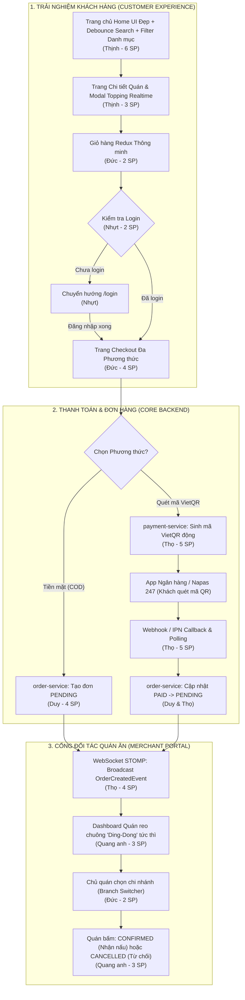

# 📋 BÁO CÁO KẾ HOẠCH SPRINT 2 (SPRINT 2 PLANNING REPORT)
## DỰ ÁN: THUNDER FOOD DELIVERY (SPRING BOOT MICROSERVICES + REACT 19 TS CLIENT)

> **Phương pháp quản lý:** Agile / Scrum (OJT Standard Framework)  
> **Thời gian thực hiện dự kiến:** 02/11/2026 – 15/11/2026 (2 tuần)  
> **Tổng Story Points cam kết:** **52 SP**  
> **Tài liệu căn cứ:** [`document/backlog.md`](file:///d:/ojt-food-deli-start/document/backlog.md), [`TRELLO_BACKLOG_PLAN.md`](file:///d:/ojt-food-deli-start/TRELLO_BACKLOG_PLAN.md), [`document/Srs.md`](file:///d:/ojt-food-deli-start/document/Srs.md), và Báo cáo tổng kết Sprint 1.

---

## 🎯 I. MỤC TIÊU TỐI THƯỢNG CỦA SPRINT 2 (SPRINT GOAL)

> **Sprint Goal:**  
> *"Dứt điểm toàn bộ nợ kỹ thuật từ Sprint 1; hoàn thiện khép kín 100% trải nghiệm đặt món của Khách hàng (khám phá thực đơn, tùy chọn topping, giỏ hàng Redux, checkout bảo mật, thanh toán VietQR & COD); và triển khai toàn diện Cổng Đối tác Quán ăn (Merchant Portal) nhận đơn thời gian thực kèm chuông báo WebSocket STOMP."*

### 📌 Chiến Lược Trọng Tâm & Nguyên Tắc Thực Thi
1. **Tập trung tuyệt đối vào 2 đối tượng: Khách hàng (Customer) & Đối tác Quán ăn (Merchant):**
   - Tạm hoãn toàn bộ phân hệ Tài xế (Driver/Shipper Hub) sang **trọn vẹn Sprint 3** để không bị phân tán tài nguyên.
   - Tập trung nguồn lực xử lý luồng đặt hàng và thanh toán thật mượt mà, thông suốt.
2. **Dứt điểm Nợ kỹ thuật (Technical Debt) từ Sprint 1:**
   - Cơ chế Đăng nhập/Đăng ký tập trung (**Unified Auth**: duy nhất 1 form `/login` và 1 form `/register` cho mọi Role).
   - Thanh Header điều hướng động theo Role (`ROLE_CUSTOMER`, `ROLE_MERCHANT`, `ROLE_DRIVER`, `ROLE_ADMIN`).
   - Xóa bỏ toàn bộ dữ liệu giả lập (mock data) ở Trang chủ và Giỏ hàng; kết nối 100% API thật từ `restaurant-service` và `order-service`.
   - Bọc Route Guard `<ProtectedRoute>` bảo vệ thanh toán, tự động chuyển hướng đăng nhập.
3. **Hoàn thiện Cổng Thanh toán & Hạ tầng Realtime (Thọ - Leader phụ trách):**
   - Tích hợp cổng thanh toán trực tuyến quét mã **VietQR (Napas 247)** (sinh mã VietQR động chuẩn EMVCo/VietQR API kèm nội dung đơn hàng, Webhook/IPN xác nhận giao dịch tự động, polling tra cứu trạng thái và cập nhật đơn hàng).
   - Thiết lập hạ tầng **Spring WebSocket STOMP Hub** (`/ws-food-deli`), phát chuông báo âm thanh "ding-dong" tức thì khi Quán có đơn mới.

---

## 👥 II. MA TRẬN NĂNG LỰC & PHÂN BỔ NHÂN SỰ (TEAM CAPACITY & VELOCITY)

Toàn đội gồm **6 thành viên**, tổng khối lượng công việc được cân bằng kỹ lưỡng theo chuyên môn cốt lõi:

| Thành viên | Vai trò chính | Chuyên môn cốt lõi | Story Points (SP) | Tỷ lệ đóng góp | Trách nhiệm chính trong Sprint 2 |
| :--- | :--- | :--- | :---: | :---: | :--- |
| **Thọ** | **Leader & Architect** | Gateway, Payment, WebSocket, Docker | **9 SP** | 17.3% | • Tích hợp Cổng thanh toán Quét mã VietQR (5 SP).<br>• Thiết lập WebSocket STOMP Hub & Chuông báo đơn (4 SP). |
| **Duy** | **Backend Core Engineer** | Spring Data JPA, Concurrency, ACID | **7 SP** | 13.5% | • Lõi `order-service` xử lý đặt hàng ACID (4 SP).<br>• Backend API Quản lý Topping & gán món ăn (3 SP). |
| **Quang anh** | **Backend / Fullstack** | Spring Boot, Merchant Portal, REST | **12 SP** | 23.1% | • Merchant Dashboard xử lý đơn Realtime (3 SP).<br>• CRUD Món ăn & Toggle Còn/Hết hàng (3 SP).<br>• Giao diện Quản lý Topping Quán (4 SP).<br>• Quản lý Menu Category & Voucher Quán (2 SP). |
| **Nhựt** | **Frontend Core Engineer** | React 19, Auth, Router Guard, State | **7 SP** | 13.5% | • Header Role-Nav & Unified Auth UI (2 SP).<br>• Route Guard Checkout & Redirect (2 SP).<br>• Màn hình Lịch sử Đơn hàng `/orders` (3 SP). |
| **Thịnh** | **Frontend Engineer** | UI/UX, Search, Category Filter | **9 SP** | 17.3% | • Redesign Home UI chuẩn đẹp ShopeeFood (2 SP).<br>• Category Filter & Debounce Search (2 SP).<br>• Gắn API Quán/Món thật cho Trang chủ (2 SP).<br>• Trang Chi tiết Quán & Modal Topping (3 SP). |
| **Đức** | **Frontend Portals** | Redux Toolkit, Dashboard, Checkout | **8 SP** | 15.4% | • Đồng bộ Giỏ hàng Redux (2 SP).<br>• Bộ chọn Đa chi nhánh 1-Merchant-Many-Shops (2 SP).<br>• Giao diện Checkout Đa phương thức COD & VietQR (4 SP). |
| **TỔNG CỘNG**| **6 thành viên** | **Fullstack Microservices + React** | **52 SP** | **100%** | **17 Thẻ Trello phân bố trên 3 Phân hệ chính** |

---

## 🗺️ III. SƠ ĐỒ LUỒNG TỔNG THỂ SPRINT 2 (END-TO-END FLOW)



---

## 📋 IV. CHI TIẾT SPRINT BACKLOG (17 THẺ TRELLO)

---

### PHẦN A: CẢI THIỆN NỢ SPRINT 1 & TRẢI NGHIỆM KHÁCH HÀNG (22 SP)

#### 🎴 Thẻ SP2-CUST-01: Cải thiện Giao diện Trang chủ (Home UI Redesign) Chuẩn Đẹp
* **Người phụ trách:** `Thịnh`
* **Nhãn (Labels):** `Frontend`, `Bug / Debt`
* **Story Points:** 2 SP
* **Mục tiêu:** Thiết kế lại toàn bộ Trang chủ (`HomePage.tsx`) theo phong cách hiện đại (ShopeeFood/GrabFood standard).
* **Tiêu chí hoàn thành (Acceptance Criteria):**
  - [ ] Hero Banner bắt mắt kèm thanh tìm kiếm nổi bật.
  - [ ] Layout Card quán ăn chuẩn UX: hình ảnh sắc nét, huy hiệu sao đánh giá, thời gian giao dự kiến, khoảng cách km.
  - [ ] Giao diện responsive 100% mượt mà trên Mobile và Desktop.

#### 🎴 Thẻ SP2-CUST-02: Bổ sung Bộ lọc Danh mục (Category Filter) & Tìm kiếm Debounce Search
* **Người phụ trách:** `Thịnh`
* **Nhãn (Labels):** `Frontend`, `Bug / Debt`
* **Story Points:** 2 SP
* **Mục tiêu:** Bổ sung thanh cuộn Category ẩm thực và ô tìm kiếm tức thì không lag/giật.
* **Tiêu chí hoàn thành (Acceptance Criteria):**
  - [ ] Thanh icon danh mục (Cơm, Bún/Phở, Trà sữa, Ăn vặt, Đồ chay, Tráng miệng...): click danh mục tự động lọc danh sách quán/món.
  - [ ] Tích hợp Debounce 300ms cho ô tìm kiếm `Input.Search`, tự động gọi filter dữ liệu thời gian thực.

#### 🎴 Thẻ SP2-CUST-03: Gắn API Quán ăn & Món ăn Thật cho Trang chủ (Bỏ Mock Data)
* **Người phụ trách:** `Thịnh`
* **Nhãn (Labels):** `Frontend`, `High Priority`
* **Story Points:** 2 SP
* **Mục tiêu:** Xóa bỏ hoàn toàn mảng tĩnh `FEATURED_ITEMS`, kết nối API thật từ `restaurant-service` qua API Gateway.
* **Tiêu chí hoàn thành (Acceptance Criteria):**
  - [ ] Gọi API `restaurantApi.getAll()` trong `useEffect` hiển thị dữ liệu thật từ database MySQL.
  - [ ] Hiển thị Skeleton loading khi đang fetch và Empty state khi không tìm thấy kết quả.

#### 🎴 Thẻ SP2-CUST-04: Xây dựng Trang Chi tiết Quán & Thực đơn (`/restaurants/:id`) kèm Modal Topping
* **Người phụ trách:** `Thịnh`
* **Nhãn (Labels):** `Frontend`, `High Priority`
* **Story Points:** 3 SP
* **Mục tiêu:** Màn hình chi tiết quán ăn, hiển thị menu phân nhóm danh mục và popup chọn topping tính tiền realtime.
* **Tiêu chí hoàn thành (Acceptance Criteria):**
  - [ ] Route `/restaurants/:id` hiển thị thông tin quán (tên, địa chỉ, giờ mở cửa, rating).
  - [ ] Danh sách món ăn được gom nhóm theo Category.
  - [ ] Modal chọn Topping: cho phép chọn size (Nhỏ/Vừa/Lớn), độ ngọt, đá, topping kèm; tổng tiền tự động nhảy theo thời gian thực trước khi bấm "Thêm vào giỏ hàng".

#### 🎴 Thẻ SP2-CUST-05: Nâng cấp Header Navigation theo Role & Cơ chế Đăng nhập Tập trung
* **Người phụ trách:** `Nhựt`
* **Nhãn (Labels):** `Frontend`, `Bug / Debt`
* **Story Points:** 2 SP
* **Mục tiêu:** Header nhận diện Role từ JWT token. Giữ vững quy tắc: Duy nhất 1 trang `/login` và 1 trang `/register`.
* **Tiêu chí hoàn thành (Acceptance Criteria):**
  - [ ] Thanh điều hướng Header mượt mà: Logo, Trang chủ, Quán ăn, Đơn hàng của tôi, Giỏ hàng.
  - [ ] Dropdown Avatar hiển thị menu động theo Role:
    - `ROLE_CUSTOMER`: Hồ sơ cá nhân, Lịch sử đơn hàng.
    - `ROLE_MERCHANT`: Hiển thị thêm *"Quán ăn của tôi (Merchant Portal)"*.
    - `ROLE_DRIVER`: Hiển thị thêm *"Cổng làm việc Tài xế (Shipper Hub)"*.
    - `ROLE_ADMIN`: Hiển thị thêm *"Trang Quản trị Hệ thống (Admin Portal)"*.
  - [ ] Đăng xuất và dọn dẹp LocalStorage / Redux an toàn.

#### 🎴 Thẻ SP2-CUST-06: Bọc Route Guard cho Checkout & Chuyển hướng Login khi Chưa Đăng Nhập
* **Người phụ trách:** `Nhựt`
* **Nhãn (Labels):** `Frontend`, `High Priority`, `Bug / Debt`
* **Story Points:** 2 SP
* **Mục tiêu:** Bảo vệ tuyến đường thanh toán, ngăn chặn khách vãng lai (anonymous) checkout khi chưa xác thực.
* **Tiêu chí hoàn thành (Acceptance Criteria):**
  - [ ] Tại `CartPage.tsx`: Bấm "Tiến hành đặt hàng" khi chưa login $\rightarrow$ cảnh báo và điều hướng sang `/login` kèm `state: { from: '/checkout' }`.
  - [ ] Tuyến đường `/checkout` được bọc bên trong `<ProtectedRoute>`.
  - [ ] Đăng nhập thành công $\rightarrow$ tự động chuyển tiếp quay lại đúng `/checkout`.

#### 🎴 Thẻ SP2-CUST-07: Xây dựng Trang Lịch sử Đơn hàng của Khách hàng (`/orders`)
* **Người phụ trách:** `Nhựt`
* **Nhãn (Labels):** `Frontend`, `High Priority`
* **Story Points:** 3 SP
* **Mục tiêu:** Trang theo dõi danh sách đơn hàng của khách hàng đang đăng nhập.
* **Tiêu chí hoàn thành (Acceptance Criteria):**
  - [ ] Route `/orders` gọi API `GET /api/v1/orders/my-orders` theo `X-User-Id`.
  - [ ] Hiển thị danh sách thẻ đơn hàng: Mã đơn, Tên quán ăn, Thời gian đặt, Tổng tiền, Huy hiệu trạng thái đơn (`PENDING`, `CONFIRMED`, `DELIVERING`, `COMPLETED`, `CANCELLED`), Phương thức thanh toán (COD / VietQR).
  - [ ] Nút "Xem chi tiết" mở xem danh sách món ăn, số lượng và topping đã đặt.

#### 🎴 Thẻ SP2-CUST-08: Đồng bộ Giỏ hàng Redux & Xóa Bỏ Dữ liệu Giả Lập
* **Người phụ trách:** `Đức` (Phối hợp Backend: `Duy`)
* **Nhãn (Labels):** `Frontend`, `Backend / Redis`, `Completed`
* **Story Points:** 2 SP
* **Mục tiêu:** Loại bỏ dữ liệu tĩnh giả lập (`MOCK_STORE`, `MOCK_FOODS`), kết nối Redux Store tập trung và đồng bộ giỏ hàng với Redis (`order-service`).
* **Tiêu chí hoàn thành (Acceptance Criteria):**
  - [x] Giỏ hàng lấy dữ liệu từ `state.cart.items` và đồng bộ 2 chiều với Redis (`foodthunder:cart:{userId}`, TTL 30 ngày).
  - [x] Áp dụng **Ràng buộc Một Quán Duy Nhất (Single-Shop Constraint)**: nếu thêm món từ quán khác $\rightarrow$ hiển thị modal xác nhận xóa giỏ cũ để tạo giỏ mới (cả frontend Redux lẫn backend Redis).
  - [x] Tăng/giảm số lượng, xóa món, lưu trạng thái giỏ hàng vào `localStorage` kèm cơ chế optimistic update và background Redis sync.

#### 🎴 Thẻ SP2-CUST-09: Hoàn thiện Lõi Backend `order-service` Xử lý Đặt hàng ACID *(Khắc phục nợ thẻ 1.4)*
* **Người phụ trách:** `Duy`
* **Nhãn (Labels):** `Backend`, `High Priority`
* **Story Points:** 4 SP
* **Mục tiêu:** Xử lý logic tạo đơn hàng giao dịch ACID, xác thực giá và trạng thái quán ăn qua OpenFeign.
* **Tiêu chí hoàn thành (Acceptance Criteria):**
  - [ ] API `POST /api/v1/orders` chạy trong Transaction ACID, kiểm tra quán mở cửa và sản phẩm khả dụng qua `restaurant-service`.
  - [ ] Đơn hàng COD lưu trạng thái ban đầu là `PENDING`; đơn hàng VietQR lưu trạng thái ban đầu là `AWAITING_PAYMENT`.
  - [ ] API `GET /api/v1/orders/my-orders` lấy danh sách đơn của khách hàng đang đăng nhập.
  - [ ] API `PUT /api/v1/orders/{id}/status` kiểm tra nghiêm ngặt ma trận chuyển đổi trạng thái State Machine.

---

### PHẦN B: HẠ TẦNG THANH TOÁN VIETQR & REALTIME WEBSOCKET (THỌ PHỤ TRÁCH) (9 SP)

#### 🎴 Thẻ SP2-CORE-01: Tích hợp Cổng thanh toán Quét mã VietQR (Napas 247) Toàn diện
* **Người phụ trách:** `Thọ` (Phối hợp Frontend: `Đức`)
* **Nhãn (Labels):** `Backend / Fullstack`, `High Priority`
* **Story Points:** 5 SP
* **Mục tiêu:** Xây dựng phân hệ thanh toán quét mã VietQR (Napas 247) tự động sinh mã QR động kèm nội dung đơn hàng, tích hợp Webhook/IPN xác nhận giao dịch tự động và API polling trạng thái thanh toán.
* **Tiêu chí hoàn thành (Acceptance Criteria):**
  - [ ] Cấu hình tài khoản thụ hưởng ngân hàng (`bankId` / BIN, `accountNo`, `accountName`, VietQR Template, Client ID/API Key nếu qua cổng VietQR Open API).
  - [ ] Thuật toán tạo mã VietQR động chuẩn Napas 247 / EMVCo hoặc URL ảnh QR từ VietQR API (`https://img.vietqr.io/image/...`) tích hợp chính xác số tiền và nội dung chuyển khoản định danh duy nhất (`FOODDELI {orderId}`).
  - [ ] API `POST /api/v1/payments/vietqr/generate`: Nhận `orderId` và `amount` $\rightarrow$ sinh payload VietQR (URL ảnh QR, mã EMVCo QR code string, thông tin ngân hàng thụ hưởng, số tiền, cú pháp chuyển khoản và thời gian hết hạn).
  - [ ] API `POST /api/v1/payments/vietqr/webhook`: Webhook Server-to-Server tiếp nhận thông báo biến động số dư / thanh toán từ cổng/ngân hàng (xác thực chữ ký bảo mật) $\rightarrow$ Trích xuất `orderId`, đối soát số tiền $\rightarrow$ Cập nhật trạng thái `PAID` và đồng bộ `order-service` sang `PENDING`.
  - [ ] API `GET /api/v1/payments/orders/{orderId}/status`: Endpoint tra cứu trạng thái thanh toán đơn hàng (phục vụ Polling kiểm tra trạng thái từ frontend khi khách đang mở modal quét mã).
  - [ ] API `POST /api/v1/payments/cod`: Khởi tạo thanh toán tiền mặt khi nhận hàng.

#### 🎴 Thẻ SP2-CORE-02: Thiết lập Realtime WebSocket STOMP Hub & Chuông Báo Đơn Quán Ăn
* **Người phụ trách:** `Thọ` (Phối hợp Frontend: `Quang anh`)
* **Nhãn (Labels):** `Backend / Architecture`, `High Priority`
* **Story Points:** 4 SP
* **Mục tiêu:** Thiết lập hạ tầng WebSocket STOMP đẩy sự kiện đơn hàng thời gian thực, kích hoạt chuông reo "ding-dong" tức thì tại Quán ăn.
* **Tiêu chí hoàn thành (Acceptance Criteria):**
  - [ ] Cấu hình Spring WebSocket STOMP endpoint `/ws-food-deli`, kênh đích `/topic/merchant/{shopId}/orders`.
  - [ ] Khi đơn hàng được tạo (COD) hoặc thanh toán thành công (VietQR) $\rightarrow$ Backend tự động broadcast `OrderCreatedEvent`.
  - [ ] Client Merchant: Listener WebSocket bắt sự kiện $\rightarrow$ tự động phát âm thanh chuông "ding-dong" và hiển thị popup thông báo đơn hàng mới.
  - [ ] Đảm bảo cơ chế tự động kết nối lại (Auto-reconnect) khi rớt mạng hoặc timeout.

---

### PHẦN C: HOÀN THIỆN TOÀN DIỆN CỔNG ĐỐI TÁC QUÁN ĂN (MERCHANT PORTAL) (21 SP)

#### 🎴 Thẻ SP2-MERCH-01: Bộ chọn Đa Chi nhánh / Đa Quán Ăn (1 Merchant - Nhiều Chi Nhánh)
* **Người phụ trách:** `Đức` (Phối hợp Backend: `Quang anh`)
* **Nhãn (Labels):** `Frontend`, `High Priority`
* **Story Points:** 2 SP
* **Mục tiêu:** Hỗ trợ đối tác sở hữu nhiều quán ăn/chi nhánh trên cùng một tài khoản Merchant.
* **Tiêu chí hoàn thành (Acceptance Criteria):**
  - [ ] Gọi API `GET /api/v1/restaurants/mine` lấy danh sách toàn bộ các quán thuộc quyền sở hữu của đối tác.
  - [ ] Dropdown chọn chi nhánh trên thanh Header của Merchant Portal (tên quán, địa chỉ, trạng thái Đang mở / Tạm đóng).
  - [ ] Khi chủ quán chuyển chi nhánh $\rightarrow$ Toàn bộ dữ liệu đơn hàng, món ăn và doanh thu tự động reload theo đúng `restaurantId` đã chọn.

#### 🎴 Thẻ SP2-MERCH-02: Màn hình Thanh toán Checkout Đa Phương thức (COD & VietQR) *(Khắc phục nợ thẻ 1.5)*
* **Người phụ trách:** `Đức` (Phối hợp: `Thọ`)
* **Nhãn (Labels):** `Frontend`, `High Priority`
* **Story Points:** 4 SP
* **Mục tiêu:** Hoàn thiện giao diện màn hình Checkout cho phép khách chọn Tiền mặt (COD) hoặc Quét mã Chuyển khoản VietQR (Napas 247).
* **Tiêu chí hoàn thành (Acceptance Criteria):**
  - [ ] Radio button chọn phương thức: 💵 Tiền mặt khi nhận hàng (COD) và 💳 Quét mã Chuyển khoản VietQR (Napas 247).
  - [ ] Chọn **COD**: Bấm "Đặt hàng" $\rightarrow$ Gọi API tạo đơn $\rightarrow$ Xóa giỏ hàng Redux $\rightarrow$ Chuyển sang `/orders/:id`.
  - [ ] Chọn **VietQR**: Bấm "Thanh toán ngay" $\rightarrow$ Gọi API sinh mã VietQR $\rightarrow$ Mở Modal quét mã QR động Napas 247 kèm Countdown timer & hướng dẫn chuyển khoản $\rightarrow$ Lắng nghe WebSocket hoặc Polling trạng thái đơn hàng $\rightarrow$ Khi thanh toán thành công tự động chuyển sang `/orders/:id`.

#### 🎴 Thẻ SP2-MERCH-03: Merchant Dashboard Tiếp nhận & Xử lý Đơn hàng Thời Gian Thực *(Khắc phục nợ thẻ 1.8)*
* **Người phụ trách:** `Quang anh`
* **Nhãn (Labels):** `Fullstack`, `High Priority`
* **Story Points:** 3 SP
* **Mục tiêu:** Bảng điều khiển Merchant Dashboard tiếp nhận đơn, phát chuông báo và xử lý đơn hàng.
* **Tiêu chí hoàn thành (Acceptance Criteria):**
  - [ ] Danh sách đơn hàng phân chia theo các tab: `Tất cả`, `Đơn mới (PENDING)`, `Đang nấu (CONFIRMED)`, `Hoàn thành (COMPLETED)`, `Đã hủy (CANCELLED)`.
  - [ ] Chuông báo âm thanh tức thì khi có đơn mới đổ về qua WebSocket.
  - [ ] Nút thao tác 1-click: **"Xác nhận nhận đơn" (`CONFIRMED`)** hoặc **"Từ chối / Hết món" (`CANCELLED`)** có nhập lý do.

#### 🎴 Thẻ SP2-MERCH-04: Quản lý Thực đơn, Món ăn & Toggle Còn/Hết Hàng
* **Người phụ trách:** `Quang anh`
* **Nhãn (Labels):** `Fullstack`, `High Priority`
* **Story Points:** 3 SP
* **Mục tiêu:** Quản lý danh sách món ăn của từng chi nhánh, cho phép thêm mới, sửa giá, tải ảnh và bật/tắt còn hàng.
* **Tiêu chí hoàn thành (Acceptance Criteria):**
  - [ ] Bảng danh sách món ăn của quán đang chọn kèm hình ảnh, giá bán, danh mục và trạng thái.
  - [ ] Form thêm mới / chỉnh sửa món ăn (tên món, giá, mô tả, chọn danh mục, tải link ảnh).
  - [ ] Nút Switch toggle **Còn hàng / Tạm hết hàng (`isAvailable`)** cập nhật tức thì vào database.

#### 🎴 Thẻ SP2-MERCH-05: Quản lý Topping & Gán Topping vào Món Ăn
* **Người phụ trách:** `Quang anh` (Frontend & API) & `Duy` (Backend Data Model)
* **Nhãn (Labels):** `Fullstack`, `High Priority`
* **Story Points:** 7 SP *(Quang anh: 4 SP, Duy: 3 SP)*
* **Mục tiêu:** Xây dựng hệ thống nhóm Topping linh hoạt và liên kết Topping vào từng món ăn (`food_toppings`).
* **Tiêu chí hoàn thành (Acceptance Criteria):**
  - [ ] Phía Backend (`Duy`): Hoàn thiện Entity & Repository `Topping`, `ProductTopping`; API CRUD nhóm topping theo quán và API gán danh sách topping vào món ăn.
  - [ ] Phía Frontend (`Quang anh`): Màn hình quản lý Topping (tên topping, giá thêm); Giao diện phân nhóm Topping (Size, Độ ngọt, Thạch/Trân châu).
  - [ ] Màn hình chỉnh sửa món ăn: Cho phép tích chọn các nhóm topping áp dụng cho món ăn đó.

#### 🎴 Thẻ SP2-MERCH-06: Quản lý Danh mục Menu (Category) & Voucher Quán Ăn
* **Người phụ trách:** `Quang anh`
* **Nhãn (Labels):** `Fullstack`
* **Story Points:** 2 SP
* **Mục tiêu:** Tạo danh mục menu nội bộ của quán và tạo mã giảm giá (Voucher) thu hút khách hàng.
* **Tiêu chí hoàn thành (Acceptance Criteria):**
  - [ ] CRUD danh mục menu của quán (Khai vị, Món chính, Đồ uống, Tráng miệng...).
  - [ ] Quản lý Voucher của quán: Mã giảm giá, % giảm hoặc số tiền cố định, đơn giá tối thiểu áp dụng, hạn sử dụng.

---

## 🏗️ V. KIẾN TRÚC KỸ THUẬT & PHÂN ĐỊNH RANH GIỚI MICROSERVICES

Trong Sprint 2, hệ thống vận hành với **5 microservices chính** và **thư viện dùng chung**:

```
+---------------------------------------------------------------------------------+
|                                 api-gateway (Port 8080)                         |
|        JWT Auth Filter, Rate Limiting, CORS, Whitelist /api/v1/payments/vietqr/**|
+---------------------------------------------------------------------------------+
          |                       |                      |                 |
          v                       v                      v                 v
+------------------+    +-------------------+    +---------------+   +-------------------+
|  auth-service    |    | restaurant-service|    | order-service |   |  payment-service  |
|   (Port 8081)    |    |    (Port 8082)    |    |  (Port 8083)  |   |    (Port 8085)    |
+------------------+    +-------------------+    +---------------+   +-------------------+
| • Unified Login  |    | • Multi-shops     |    | • ACID Orders |   | • VietQR Napas247 |
| • Unified Reg    |    | • Menu & Products |    | • State Graph |   | • Dynamic QR Gen  |
| • Profile & Addr |    | • Toppings        |    | • Status Logs |   | • Webhook Callback|
| • User Roles     |    | • Shop Vouchers   |    | • Feign Client|   | • COD Handler     |
+------------------+    +-------------------+    +---------------+   +-------------------+
          \                       |                      /                 /
           \                      |                     /                 /
            +---------------------+--------------------+-----------------+
                                  |
                                  v
                +------------------------------------+
                |       common-library-service       |
                |  (DTOs, Enums, Events, Constants)  |
                +------------------------------------+
```

### Quy Tắc Dữ Liệu Bắt Buộc (RULE 1):
* **Plain IDs:** Tham chiếu giữa các service bắt buộc dùng Plain IDs (`Long orderId`, `Long customerId`, `Long restaurantId`). Tuyệt đối không dùng foreign key vật lý hay `@ManyToOne` xuyên service.
* **Token Propagation:** Khi `payment-service` hoặc `order-service` gọi Feign client liên dịch vụ, tự động đính kèm `X-User-Id` và `X-User-Role` (hoặc `X-User-Role: SYSTEM`).

---

## ✅ VI. TIÊU CHUẨN HOÀN THÀNH (DEFINITION OF DONE - DoD)

Một thẻ công việc chỉ được kéo sang cột **`[Sprint 2: Done]`** khi thỏa mãn đầy đủ các điều kiện:
1. **Mã nguồn (Code Quality):**
   - Tuân thủ coding standard, không để lại `TODO` hoặc biến rác chưa dùng.
   - Các service backend kế thừa DTO dùng chung từ `common-library-service`.
2. **Kiểm thử tự động (Testing):**
   - Backend: Unit test JUnit 5 + Mockito đạt độ bao phủ $\ge 80\%$ cho Service layer; Controller có `@WebMvcTest`.
   - Toàn bộ test suite chạy lệnh `mvn test` hoặc `./gradlew test` phải **PASSED 100%**.
3. **Đóng gói & Chạy Docker:**
   - Image build thành công qua Dockerfile độc lập, container start không crash, healthcheck Actuator báo `UP`.
4. **Code Review:**
   - Tạo Pull Request rõ ràng theo chuẩn, ít nhất 1 thành viên và Leader Thọ review và approve trước khi merge vào nhánh chính `develop`.

---

## ⚠️ VII. QUẢN TRỊ RỦI RO (RISK MANAGEMENT & MITIGATION)

| Rủi ro kỹ thuật | Mức độ | Hậu quả tiềm ẩn | Biện pháp phòng ngừa & Xử lý |
| :--- | :---: | :--- | :--- |
| **Lệch nội dung chuyển khoản VietQR** | Cao | Khách chuyển khoản nhưng hệ thống không tự khớp đơn do sai cú pháp. | Sinh mã QR động chuẩn Napas 247 nhúng cứng số tiền và mã đơn `FOODDELI {orderId}`; cung cấp song song API Polling trạng thái đơn và Webhook ngân hàng. |
| **Mất kết nối WebSocket STOMP** | Trung bình | Quán không nhận được chuông báo đơn mới nếu mạng chập chờn. | Client tích hợp cơ chế **Auto-reconnect** (thử lại sau 5s); bổ sung cơ chế Polling dự phòng khi WebSocket ngắt kết nối. |
| **Xung đột State Machine Đơn hàng** | Cao | Đơn hàng nhảy trạng thái không hợp lệ (ví dụ: đã hủy nhưng vẫn thanh toán). | Khóa bi quan (`SELECT ... FOR UPDATE`) trong `order-service` và `payment-service`, kiểm tra chặt chẽ `ALLOWED_TRANSITIONS`. |
| **Xung đột Giỏ hàng Nhiều Quán** | Thấp | Khách đặt món từ 2 quán khác nhau trong 1 đơn gây lỗi logic. | Ràng buộc Single-Shop Constraint ngay tại Redux Store; cảnh báo xóa giỏ cũ trước khi thêm món quán mới. |

---

## 📅 VIII. LỘ TRÌNH THỰC HIỆN THEO NGÀY (SPRINT 2 TIMELINE)

* **Ngày 1 - 3 (02/11 - 04/11):**
  - Khởi tạo `common-library-service`, cấu hình Docker compose và API Gateway routes.
  - Triển khai phân hệ `payment-service` (VietQR Generator + Webhook/Polling + COD) và hoàn thiện bộ kiểm thử tự động.
  - Xử lý triệt để các lỗi tồn đọng Sprint 1 (Home UI, Header Nav, Route Guard).
* **Ngày 4 - 7 (05/11 - 08/11):**
  - Hoàn thiện kết nối API thật cho Trang chủ, Trang Chi tiết Quán & Modal chọn Topping.
  - Hoàn thiện logic ACID Đặt hàng `order-service` và Giao diện Checkout Đa phương thức (COD & VietQR).
  - Xây dựng hạ tầng WebSocket STOMP Hub.
* **Ngày 8 - 11 (09/11 - 12/11):**
  - Xây dựng Cổng Quản lý Đối tác Quán ăn (Merchant Dashboard, Chuông Ding-Dong, Bộ chọn Đa chi nhánh).
  - Triển khai CRUD Món ăn, Toggle Còn/Hết hàng và Hệ thống Topping Quán.
  - Màn hình Lịch sử Đơn hàng Khách hàng `/orders`.
* **Ngày 12 - 14 (13/11 - 15/11):**
  - Kiểm thử tích hợp toàn diện luồng End-to-End: Khách chọn món $\rightarrow$ Checkout VietQR Napas 247 $\rightarrow$ Quán nhận đơn qua WebSocket reo chuông $\rightarrow$ Quán bấm xác nhận đơn.
  - Tối ưu hiệu năng, fix bug, đóng gói Docker và chuẩn bị Demo Sprint 2.

