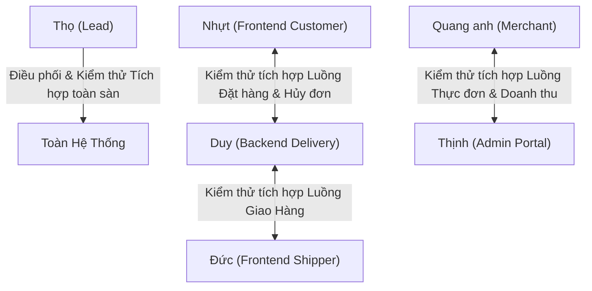

# 🚀 KẾ HOẠCH CHI TIẾT SPRINT 4 (SPRINT 4 PLANNING)
## DỰ ÁN: FOOD THUNDER DELI (SPRING BOOT MICROSERVICES + REACT 19 TS)

> **Mục tiêu cốt lõi Sprint 4:**  
> 1. Sửa dứt điểm 100% các lỗi nghiêm trọng đã phát hiện (Bug hủy đơn khách hàng, Bug tính khống thu nhập tài xế, Bug thất thoát lượt dùng Voucher, Bug giỏ hàng đa quán, Bug phân quyền IDOR).  
> 2. Phân bổ công việc chuẩn xác cho **6 thành viên** dựa trên đúng chuyên môn và các module từng phụ trách ở Sprint 1, 2, 3.  
> 3. Tiến hành kiểm thử E2E tích hợp liên thông toàn bộ 4 vai trò (Khách hàng, Quán ăn, Tài xế, Quản trị viên). **Tuyệt đối không kiểm thử Unit Test.**  
> 4. Hoàn thiện toàn bộ dự án, đóng gói môi trường Docker ổn định và sẵn sàng cho buổi bảo vệ đồ án OJT.

---

## 👥 I. BẢNG PHÂN BỔ NHÂN SỰ & STORY POINTS SPRINT 4

| Thành viên | Vai trò chính | Phạm vi phụ trách từ các Sprint trước | Nhiệm vụ trọng tâm Sprint 4 | Story Points |
| :--- | :--- | :--- | :--- | :---: |
| **Thọ (Leader)** | Lead Architect & DevOps | • Toàn bộ kiến trúc Gateway, WebSocket STOMP Hub, Chat Service, Docker Compose toàn sàn. | • Tối ưu kiến trúc API Gateway WebSocket Hub. • Điều phối kiểm thử E2E liên thông 4 vai trò. • Đóng gói Docker & Diễn tập bảo vệ đồ án OJT. | **10 SP** |
| **Duy** | Backend Core Engineer | • `delivery-service`, Concurrency Locking `SELECT ... FOR UPDATE`, Hiệu suất AR/CR, tương tác `order-service`. | • Fix BUG-01 (Lỗ hổng hủy đơn khách hàng trong `order-service`). • Fix BUG-02 (Cập nhật `COMPLETED` & sửa tính thu nhập xế). • Fix BUG-09 (Bổ sung khóa bi quan luồng trả đơn). | **9 SP** |
| **Quang anh** | Backend / Fullstack Merchant | • `restaurant-service`, Phê duyệt đối tác, Multi-shop Branch Switcher, Menu, Topping, Voucher, Doanh thu Quán. | • Fix BUG-03 (Chặn thất thoát lượt dùng Voucher `usageLimit`). • Fix BUG-05 (Chặn lỗ hổng IDOR sửa/xóa món ăn quán khác). • Fix BUG-06 (Bỏ fallback `ownerId = 3` làm rò rỉ chi nhánh). | **8 SP** |
| **Nhựt** | Frontend Core Engineer | • Giao diện Khách hàng, Giỏ hàng, Checkout, Live Tracking Stepper, Widget Live Chat (`ShopeeStyleChatDrawer`). | • Fix BUG-04 (Chặn chọn món đa quán trên Cart UI & Checkout). • Bổ sung đồng hồ đếm ngược 60s hủy đơn trên `OrderDetailPage`. • Tối ưu tính năng Đã xem (Read receipts) & Unread badge chat. | **8 SP** |
| **Thịnh** | Frontend / Admin Specialist | • Admin Portal (`/admin/users`, `/admin/settings`, `/admin/analytics`, `/admin/reviews`). | • Fix BUG-07 (Hợp nhất đồng bộ 2 trang cài đặt hệ thống Admin). • Fix BUG-08 (Đồng bộ hiển thị điểm sao đánh giá quán ăn). • Thực thi kiểm thử E2E toàn bộ luồng Quản trị viên. | **8 SP** |
| **Đức** | Frontend Shipper Specialist | • Shipper Web Hub (`/shipper`), Radar quét đơn 1-chạm, Nút trượt trạng thái giao hàng, Ví thu nhập & Lịch sử cuốc xe. | • Đồng bộ giao diện Ví thu nhập chuẩn xác sau khi Backend fix BUG-02. • Tối ưu Radar quét đơn thời gian thực & Chime chuông báo cuốc. • Thực thi kiểm thử E2E toàn bộ luồng Tài xế giao hàng. | **7 SP** |
| **CẢ TEAM** | **Sprint 4 Delivery** | **Toàn bộ hệ thống hoàn chỉnh 100% - Sẵn sàng bảo vệ OJT** | **50 SP** |

---

## 📋 II. BẢNG PHÂN CHIA TASK CHI TIẾT CHO TỪNG THÀNH VIÊN

### 1. THỌ (LEADER - ARCHITECT & DEVOPS)
> **Chuyên môn kế thừa:** Kiến trúc hệ thống Microservices, Gateway Routing, WebSocket STOMP Broker, Chat & Notification Service, Docker Compose.

* **Task THO-01: Chuẩn hóa & Cố định kiến trúc WebSocket STOMP qua API Gateway**
  * *Nội dung:* Đảm bảo route `/ws` và `/ws-food-deli` luôn trỏ trực tiếp sang `chat-notification-service` (`lb://chat-notification-service`), loại bỏ vĩnh viễn các route WebSocket cũ gây xung đột ở `order-service`. Kiểm tra tải STOMP frames khi có nhiều user cùng online.
  * *Tiêu chí nghiệm thu:* Kết nối WebSocket qua Gateway ổn định, độ trễ nhận tin nhắn chat và thông báo đơn mới dưới 50ms.
* **Task THO-02: Thiết lập Kịch bản Kiểm Thử Liên Thông (Cross-Role E2E Orchestration)**
  * *Nội dung:* Thiết lập quy trình kiểm thử đồng thời 4 vai trò trên 4 cửa sổ trình duyệt: Khách đặt đơn $\rightarrow$ Quán nhận chuông xác nhận $\rightarrow$ Xế bắt cuốc đi giao $\rightarrow$ Khách nhận hàng & đánh giá 5★.
  * *Tiêu chí nghiệm thu:* Dữ liệu cập nhật mượt mà theo thời gian thực giữa 4 màn hình mà không cần bấm F5.
* **Task THO-03: Đóng gói Docker Compose & Diễn tập bảo vệ đồ án OJT**
  * *Nội dung:* Cập nhật cấu hình môi trường `.env`, tối ưu thông số JVM Heap (`-Xmx`), kiểm tra lệnh `docker compose up -d` khởi động mượt mà cả 10 services và Web Client. Lập kịch bản Demo trực tiếp cho buổi bảo vệ đồ án.
  * *Tiêu chí nghiệm thu:* Toàn bộ container ở trạng thái `healthy`, không bị tràn RAM (OOM).

---

### 2. DUY (BACKEND CORE - DELIVERY & ORDER SERVICE)
> **Chuyên môn kế thừa:** `delivery-service`, Concurrency Locking `SELECT ... FOR UPDATE`, Hiệu suất AR/CR, tương tác OpenFeign `order-service`.

* **Task DUY-01: Khắc phục triệt để BUG-02 (Cập nhật trạng thái COMPLETED & Thu nhập tài xế)**
  * *Nội dung:* Trong `DeliveryServiceImpl.updateDeliveryStep`, khi `targetStep = "COMPLETED"`, bắt buộc cập nhật `offer.setStatus("COMPLETED")` và `offer.setDeliveredAt(LocalDateTime.now())`. Sửa hàm `getDriverMetrics` để chỉ tính thu nhập 20.000đ cho các đơn có trạng thái `"COMPLETED"` (loại bỏ điều kiện `"ACCEPTED"`).
  * *Tiêu chí nghiệm thu:* Khi tài xế mới bấm nhận đơn (`ACCEPTED`), thu nhập ví chưa tăng; chỉ khi bấm Hoàn tất đơn (`COMPLETED`), ví mới được cộng tiền.
* **Task DUY-02: Khắc phục triệt để BUG-01 (RBAC & Ràng buộc 60s Hủy Đơn Khách Hàng)**
  * *Nội dung:* Cập nhật `OrderServiceImpl.cancelOrder`:
    * Kiểm tra nếu người gọi là `CUSTOMER`: Chỉ cho phép hủy khi đơn còn `PENDING` hoặc `AWAITING_PAYMENT`. Nếu quán đã bấm `CONFIRMED` hoặc đơn đã có xế nhận, ném ngay `BadRequestException: "Đơn hàng đã được quán nấu hoặc tài xế đang giao, không thể hủy!"`.
    * Kiểm tra thời gian tạo đơn: Nếu thời gian hiện tại vượt quá 60 giây kể từ khi đặt đơn, từ chối hủy.
  * *Tiêu chí nghiệm thu:* Khách không thể hủy đơn sau 60s hoặc khi quán đã xác nhận.
* **Task DUY-03: Khắc phục BUG-09 (Bọc khóa bi quan cho luồng Tài xế trả đơn)**
  * *Nội dung:* Áp dụng `findAllByOrderIdForUpdate` hoặc `findByIdForUpdate` trong hàm `cancelOrder` của `DeliveryServiceImpl` để ngăn chặn Race Condition khi tài xế vừa trả đơn thì hệ thống nhận được request giao hàng.
  * *Tiêu chí nghiệm thu:* Không bị lỗi Deadlock hoặc dữ liệu không nhất quán khi thao tác đồng thời.

---

### 3. QUANG ANH (BACKEND / FULLSTACK MERCHANT - RESTAURANT SERVICE)
> **Chuyên môn kế thừa:** `restaurant-service`, Phê duyệt quán ăn, Multi-shop Branch Switcher, Quản lý Thực đơn, Toppings, Voucher, Doanh thu Quán.

* **Task QA-01: Khắc phục triệt để BUG-03 (Chống Thất Thoát Lượt Dùng Voucher `usageLimit`)**
  * *Nội dung:*
    * Thêm API nội bộ trong `restaurant-service`: `PUT /api/v1/vouchers/{id}/redeem` tăng `usedCount` lên 1 và kiểm tra nếu đạt `usageLimit` thì chuyển trạng thái voucher.
    * Gọi API này từ `OrderServiceImpl` khi đơn hàng được tạo/thanh toán thành công.
  * *Tiêu chí nghiệm thu:* Voucher có `usageLimit = 5` sau khi 5 đơn đặt thành công sẽ tự động khóa, đơn thứ 6 áp mã sẽ bị từ chối báo hết lượt.
* **Task QA-02: Khắc phục BUG-05 (Chặn lỗ hổng IDOR trên Thực đơn Quán ăn)**
  * *Nội dung:* Trong `ProductController`, `CategoryController`, `ToppingController`, bổ sung kiểm tra `X-User-Id` của Merchant có thực sự là chủ sở hữu của `restaurantId` hay không trước khi thực hiện `POST`, `PUT`, `DELETE`.
  * *Tiêu chí nghiệm thu:* Quán A gửi request sửa/xóa món ăn của Quán B sẽ bị chặn với mã lỗi `403 Forbidden`.
* **Task QA-03: Khắc phục BUG-06 (Loại bỏ fallback `ownerId = 3` làm rò rỉ chi nhánh)**
  * *Nội dung:* Sửa `RestaurantController.getMyRestaurants`: Nếu `headerOwnerId` null và không có `ownerId` hợp lệ truyền vào, ném `UnauthorizedException` thay vì gán mặc định bằng 3.
  * *Tiêu chí nghiệm thu:* Khách vãng lai gọi `GET /api/v1/restaurants/mine` sẽ nhận lỗi 401/403 thay vì thấy danh sách chi nhánh của Merchant ID=3.

---

### 4. NHỰT (FRONTEND CORE - CUSTOMER EXPERIENCE & REALTIME CHAT)
> **Chuyên môn kế thừa:** Giao diện Khách hàng, Giỏ hàng, Checkout, Live Tracking Stepper, Widget Live Chat 2 chiều (`ShopeeStyleChatDrawer.tsx`).

* **Task NHUT-01: Khắc phục triệt để BUG-04 (Ràng buộc Đơn Quán trên Cart UI & Checkout)**
  * *Nội dung:*
    * Trong `CartPage.tsx`: Nhóm danh sách món theo từng Quán ăn (Group by Restaurant).
    * Khi người dùng tích chọn món từ Quán A, tự động vô hiệu hóa (disable) checkbox của các món thuộc Quán B, kèm tooltip giải thích: *"Mỗi đơn hàng chỉ được đặt món từ 1 quán ăn duy nhất"*.
    * Kiểm tra trước khi bấm sang trang Checkout để đảm bảo không bao giờ xảy ra lỗi 400.
  * *Tiêu chí nghiệm thu:* Khách hàng không thể bấm Checkout nếu đang chọn món của 2 quán khác nhau.
* **Task NHUT-02: Bổ sung Đồng Hồ Đếm Ngược 60s Hủy Đơn trên `OrderDetailPage.tsx`**
  * *Nội dung:* Khi đơn hàng mới ở trạng thái `PENDING`, hiển thị đồng hồ đếm ngược trực quan: *"Bạn có thể hủy đơn trong vòng: XX giây"*. Sau 60s hoặc khi trạng thái chuyển sang `CONFIRMED`, nút Hủy đơn sẽ tự động ẩn đi hoặc disabled.
  * *Tiêu chí nghiệm thu:* Giao diện đồng bộ hoàn hảo với logic chặn ở Backend.
* **Task NHUT-03: Hoàn thiện Trải nghiệm Realtime Chat Widget**
  * *Nội dung:* Tối ưu hiển thị trạng thái đã đọc (Read receipts), đồng bộ Unread Count trên Chat Floating Pill, đảm bảo chat 2 chiều giữa Khách $\leftrightarrow$ Quán / Tài xế hiển thị tức thì không che khuất các nút đặt hàng.
  * *Tiêu chí nghiệm thu:* Tin nhắn hiển thị tức thì, chuông báo âm thanh rõ ràng, không bị trùng lặp.

---

### 5. THỊNH (FRONTEND / ADMIN SPECIALIST - ADMIN PORTAL & REVIEWS)
> **Chuyên môn kế thừa:** Giao diện Quản trị viên Admin Portal (`/admin/users`, `/admin/settings`, `/admin/analytics`, `/admin/reviews`).

* **Task THINH-01: Khắc phục BUG-07 (Hợp nhất & Chuẩn Hóa Cài Đặt Hệ Thống Admin)**
  * *Nội dung:* Hợp nhất dữ liệu giữa 2 trang `/admin/settings` và `/admin/system-settings` về 1 màn hình chuẩn duy nhất. Đảm bảo khi Admin cập nhật biểu phí vận chuyển / km và hoa hồng sàn thì gọi đúng API đồng bộ với cả `auth-service` và `order-service`.
  * *Tiêu chí nghiệm thu:* Cập nhật phí ship thành công và kiểm tra ngay trên màn hình giỏ hàng của khách hàng thấy phí mới được áp dụng.
* **Task THINH-02: Khắc phục BUG-08 (Đồng bộ Điểm Đánh Giá 5★ Quán Ăn)**
  * *Nội dung:* Đảm bảo khi Admin kiểm duyệt hoặc khi khách hàng gửi đánh giá mới, số lượng đánh giá và điểm sao trung bình được cập nhật ngay trên trang chi tiết quán và trang danh sách nhà hàng.
  * *Tiêu chí nghiệm thu:* Điểm sao và số lượt đánh giá hiển thị đồng nhất ở mọi trang.
* **Task THINH-03: Thực thi Kịch bản Kiểm Thử Toàn Diện Luồng Quản Trị Viên (Admin E2E)**
  * *Nội dung:* Chạy toàn bộ các test case `TC-ADM-01` đến `TC-ADM-05`: Phê duyệt quán ăn mới, phê duyệt tài xế KYC, khóa/mở khóa tài khoản người dùng, xử lý đánh giá vi phạm.
  * *Tiêu chí nghiệm thu:* Tất cả các tính năng Admin phản hồi chính xác, không phát sinh lỗi giao diện.

---

### 6. ĐỨC (FRONTEND SHIPPER SPECIALIST - SHIPPER WEB HUB)
> **Chuyên môn kế thừa:** Giao diện Shipper Hub (`/shipper`), Radar quét đơn hàng, Lộ trình giao hàng ảo hóa, Nút trượt trạng thái giao hàng, Ví thu nhập & Lịch sử cuốc xe.

* **Task DUC-01: Đồng bộ Giao diện Ví Thu Nhập & Lịch Sử Cuốc Xe Tài Xế**
  * *Nội dung:* Cập nhật màn hình `ShipperHistoryPage.tsx` và widget ví trong `ShipperHubPage.tsx`:
    * Chỉ hiển thị cộng tiền 20.000đ khi cuốc xe có trạng thái `COMPLETED`.
    * Đơn đang đi giao (`DELIVERING`, `PICKING_UP`, `ACCEPTED`) hiển thị ở mục *"Đang thực hiện (Chờ quyết toán)"*.
  * *Tiêu chí nghiệm thu:* Số liệu thu nhập hiển thị khớp 100% với dữ liệu từ Backend sau khi sửa BUG-02.
* **Task DUC-02: Tối ưu Radar Quét Đơn Hàng Mới Thời Gian Thực**
  * *Nội dung:*
    * Đảm bảo `driverWebSocket` lắng nghe mượt mà topic `/topic/drivers/available-orders`.
    * Khi có đơn mới: Phát chuông báo cuốc xe, hiện popup radar đếm ngược 30 giây để tài xế bấm nhận.
    * Khi tài xế đang có 1 đơn đang giao: Tự động ẩn radar đơn mới (Single Active Order Rule).
  * *Tiêu chí nghiệm thu:* Trải nghiệm nhận đơn mượt mà, không bị sót đơn.
* **Task DUC-03: Thực thi Kịch bản Kiểm Thử Toàn Diện Luồng Tài Xế (Driver E2E)**
  * *Nội dung:* Chạy toàn bộ các test case `TC-DRV-01` đến `TC-DRV-05`: Bật/tắt Online, Nhận đơn chống Race Condition, Trượt cập nhật tiến trình 3 bước, Tính tỷ lệ AR/CR và kiểm tra cơ chế phạt.
  * *Tiêu chí nghiệm thu:* Toàn bộ luồng tài xế vận hành trơn tru từ khi nhận đơn đến lúc hoàn tất.

---

## 🔄 III. MA TRẬN PHỐI HỢP KIỂM THỬ CHÉO (CROSS-TESTING MATRIX)

Để đảm bảo tính khách quan và phát hiện triệt để các góc khuất, các thành viên sẽ kiểm thử chéo luồng của nhau:

* **Cặp 1: Duy (Backend) $\longleftrightarrow$ Đức (Frontend):** Kiểm thử luồng Tài xế giao hàng và chống Race Condition khi nhiều tài xế cùng tranh cuốc.
* **Cặp 2: Quang anh (Backend) $\longleftrightarrow$ Thịnh (Frontend):** Kiểm thử luồng Phê duyệt Quán ăn / Tài xế và cài đặt cấu hình hoa hồng sàn của Admin.
* **Cặp 3: Nhựt (Frontend) $\longleftrightarrow$ Duy (Backend):** Kiểm thử luồng Đặt hàng, Áp mã Voucher, Hủy đơn trong 60s và đồng bộ giỏ hàng đơn quán.
* **Thọ (Leader):** Kiểm thử toàn bộ luồng WebSocket Chat 3 bên (Khách - Quán - Xế), kiểm tra tải và kiểm tra an toàn dữ liệu trên Docker Compose.

---

## 📅 IV. LỊCH TRÌNH THỰC HIỆN SPRINT 4 (TIMELINE 2 TUẦN)

* **Tuần 1 (Ngày 1 - Ngày 5): Triển khai sửa dứt điểm các Bug trọng tâm**
  * *Ngày 1 - 2:* Duy fix BUG-01, BUG-02; Quang anh fix BUG-03, BUG-05, BUG-06; Thọ tối ưu Gateway STOMP.
  * *Ngày 3 - 4:* Nhựt fix BUG-04 & Countdown hủy đơn; Thịnh fix BUG-07, BUG-08; Đức cập nhật giao diện Ví thu nhập.
  * *Ngày 5:* Đóng gói các bản build Backend & Frontend, cập nhật toàn bộ container Docker.
* **Tuần 2 (Ngày 6 - Ngày 10): Kiểm thử E2E liên thông, Tối ưu & Diễn tập bảo vệ**
  * *Ngày 6 - 7:* Thực thi Ma trận kiểm thử chéo 25 Test Scenarios liên thông 4 vai trò.
  * *Ngày 8:* Kiểm tra khả năng chịu tải và kịch bản Race Condition tranh đơn tài xế.
  * *Ngày 9:* Hoàn thiện tài liệu Báo cáo nghiệm thu Sprint 4 (Report Sprint 4).
  * *Ngày 10:* Diễn tập Demo toàn bộ hệ thống cho buổi bảo vệ đồ án OJT trước hội đồng.
