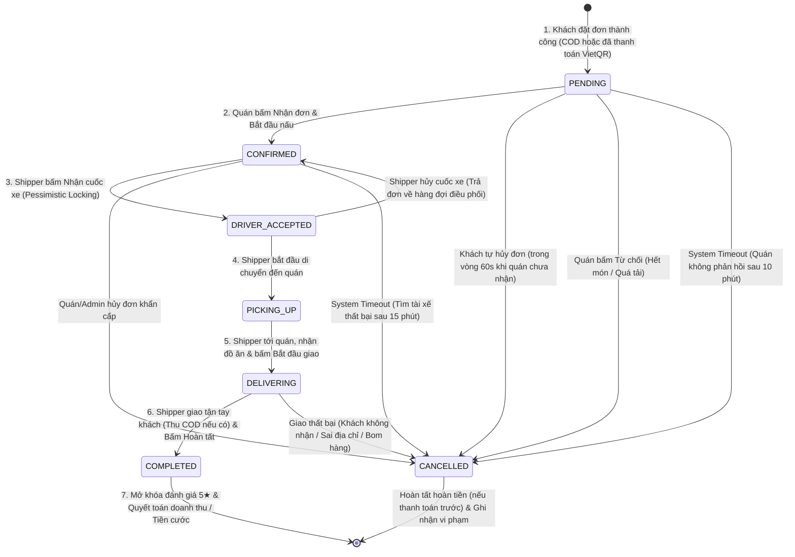
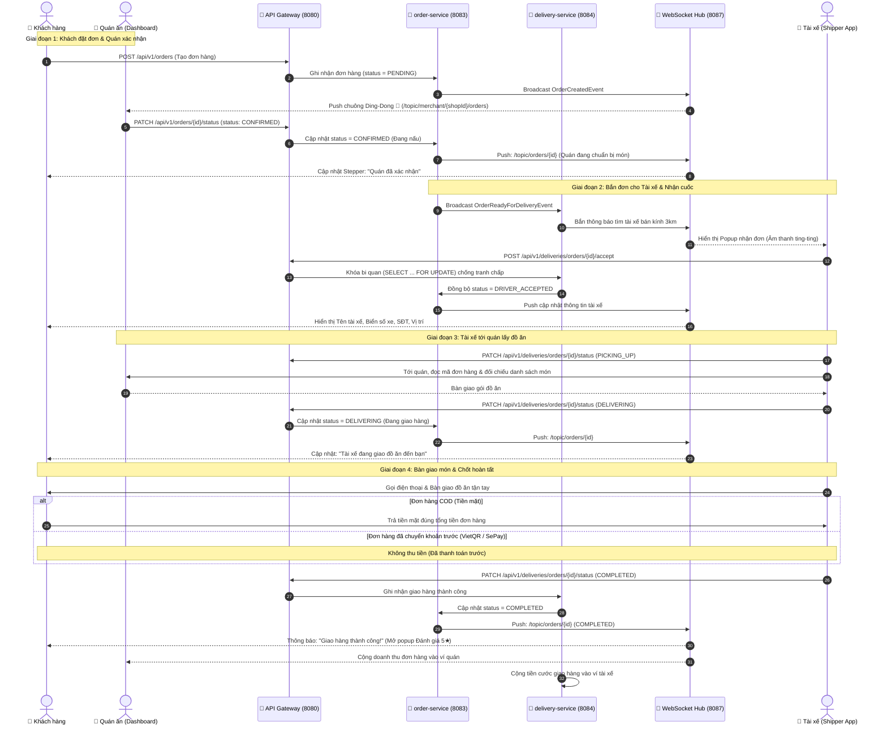

# 📦 QUY TRÌNH QUẢN LÝ VÒNG ĐỜI & TRẠNG THÁI ĐƠN HÀNG (ORDER STATUS FLOW)

> **Phân hệ chính:** `order-service` $\longleftrightarrow$ `delivery-service` $\longleftrightarrow$ `restaurant-service` $\longleftrightarrow$ `chat-notification-service` (WebSocket Hub)  
> **Các bên tham gia (Actors):** 👤 **Khách hàng (Customer)** | 🏪 **Chủ quán (Merchant)** | 🛵 **Tài xế (Driver / Shipper)** | ⚙️ **Quản trị viên (Admin / System)**

---

## 🗺️ 1. SƠ ĐỒ CHUYỂN ĐỔI TRẠNG THÁI (STATE MACHINE DIAGRAM)

---

## 🔄 2. SƠ ĐỒ TUẦN TỰ ĐIỀU PHỐI (SEQUENCE DIAGRAM)

---

## 📊 3. BẢNG MA TRẬN PHÂN QUYỀN TRẠNG THÁI (RBAC TRANSITION MATRIX)

| Mã trạng thái | Tên trạng thái | Người thực hiện | Điều kiện tiên quyết | Hành động nghiệp vụ kéo theo |
| :--- | :--- | :--- | :--- | :--- |
| **`PENDING`** | Chờ xác nhận | 👤 **Khách hàng** | Giỏ hàng hợp lệ, thanh toán COD hoặc đã có xác nhận VietQR. | Đẩy chuông ding-dong tới Merchant Dashboard; trừ số lượng tồn kho tạm thời. |
| **`CONFIRMED`** | Quán đã nhận | 🏪 **Chủ quán** | Đơn đang ở `PENDING`. | Quán bắt đầu chuẩn bị món ăn; kích hoạt phát sóng tìm tài xế gần quán. |
| **`DRIVER_ACCEPTED`**| Tài xế đã nhận | 🛵 **Tài xế** | Đơn đang ở `CONFIRMED`; chưa có tài xế nào khác nhận (Locking). | Khóa đơn với tài xế; gửi thông tin tài xế và tọa độ GPS cho khách. |
| **`PICKING_UP`** | Đang đến quán | 🛵 **Tài xế** | Đơn đang ở `DRIVER_ACCEPTED`. | Hiển thị lộ trình điều hướng từ vị trí tài xế đến quán ăn trên bản đồ. |
| **`DELIVERING`** | Đang giao hàng | 🛵 **Tài xế** | Tài xế đã đến quán và nhận đủ túi hàng từ chủ quán. | Trạng thái chuyển sang giao hàng; khách theo dõi vị trí shipper di chuyển về nhà. |
| **`COMPLETED`** | Hoàn thành | 🛵 **Tài xế duy nhất** | Đồ ăn đã giao tận tay khách; đã thu đủ tiền COD (nếu có). | Quyết toán doanh thu cho quán; cộng phí ship cho shipper; mở khóa review 5★. |
| **`CANCELLED`** | Đã hủy | 👤 Khách / 🏪 Quán / ⚙️ Hệ thống | Chỉ được hủy khi đơn chưa chuyển sang `DELIVERING`. | Hoàn tiền về ví khách (nếu trả trước); hoàn lại số lượng tồn kho; ghi nhận phạt nếu lỗi do tài xế/quán. |

---

## 🔍 4. GIẢI THÍCH CHI TIẾT NGHIỆP VỤ TỪNG BƯỚC

### Bước 1: Khách hàng Đặt đơn (`PENDING`)
* Khách bấm "Đặt đơn" tại màn hình Checkout.
* Nếu là **COD**: Đơn hàng lưu ngay với trạng thái `PENDING`.
* Nếu là **VietQR (SePay)**: Trạng thái ban đầu là `AWAITING_PAYMENT`, sau khi Webhook ngân hàng khớp tiền thành công sẽ tự động chuyển thành `PENDING`.
* Lúc này khách hàng có quyền hủy đơn miễn phí trong vòng **60 giây** nếu thay đổi ý định.

### Bước 2: Quán ăn Xác nhận chuẩn bị món (`CONFIRMED`)
* Quán ăn nghe chuông thông báo *"Bạn có đơn hàng mới!"*.
* Chủ quán kiểm tra nguyên liệu món ăn và bấm **"Xác nhận đơn"** (`CONFIRMED`).
* **Quy tắc bắt buộc:** Sau khi quán đã bấm `CONFIRMED`, khách hàng **không thể tự ý hủy đơn** trên ứng dụng nhằm bảo vệ quyền lợi chuẩn bị món ăn của nhà hàng.

### Bước 3: Điều phối & Tài xế nhận cuốc (`DRIVER_ACCEPTED`)
* Hệ thống `delivery-service` quét tài xế đang trực tuyến (Online) trong bán kính 3km quanh quán.
* Tài xế bấm **"Nhận đơn"**:
  * Áp dụng kỹ thuật **Pessimistic Locking (`SELECT ... FOR UPDATE`)** để đảm bảo 1 đơn chỉ có duy nhất 1 tài xế nhận, triệt tiêu hoàn toàn Race Condition khi nhiều tài xế cùng bấm một lúc.

### Bước 4: Tài xế tới quán lấy món (`PICKING_UP` $\rightarrow$ `DELIVERING`)
* Tài xế chạy đến quán, mở app xuất trình mã đơn hàng (Order ID).
* Quán đối chiếu món và bàn giao túi hàng kín (có niêm phong).
* Tài xế kiểm tra túi hàng và bấm nút **"Đã lấy món / Bắt đầu giao hàng"**:
  * Trạng thái đơn hàng chuyển sang **`DELIVERING`**.
  * Phía khách hàng: Ứng dụng cập nhật thông báo *"Tài xế đang giao đồ ăn đến bạn"* kèm thời gian ước tính (ETA).

### Bước 5: Bàn giao món & Chốt hoàn tất (`COMPLETED`)
* Tài xế đến địa chỉ giao hàng, gọi điện thoại cho khách ra nhận.
* **Quy tắc quan trọng nhất:** 
  > **Chỉ có Tài xế (Shipper) mới có thẩm quyền bấm "Hoàn tất đơn hàng" (`COMPLETED`)**.  
  > Quán ăn không được phép chuyển trạng thái này vì quán không trực tiếp chứng kiến việc giao nhận tại nhà khách.
* Trường hợp COD: Tài xế thu đủ tiền mặt từ khách trước khi bấm nút xác nhận.
* Ngay khi tài xế bấm **"Giao thành công"**:
  1. Đơn hàng chuyển sang `COMPLETED`.
  2. Hệ thống cộng tiền cước vào ví Shipper.
  3. Hệ thống cộng tiền bán hàng (sau khi trừ chiết khấu sàn) vào ví Merchant.
  4. Màn hình của khách hàng tự động bật Modal **"Đánh giá món ăn & dịch vụ giao hàng (1 - 5★)"**.

---

## 🛡️ 5. CÁC QUY TẮC RÀNG BUỘC KỸ THUẬT (SECURITY & INTEGRITY GUARDS)

1. **Chống nhảy cóc trạng thái (Transition Guard):**
   * Backend kiểm tra trạng thái cũ trước khi cho phép chuyển trạng thái mới:
     $$\text{PENDING} \longrightarrow \text{CONFIRMED} \longrightarrow \text{DELIVERING} \longrightarrow \text{COMPLETED}$$
   * Nghiêm cấm mọi hành vi gọi API nhảy cóc từ `PENDING` thẳng lên `COMPLETED`.
2. **Bảo vệ bằng Spring Security & Gateway Identity Injection:**
   * Gateway trích xuất thông tin người dùng từ JWT và đẩy vào Headers:
     * `X-User-Id`: ID người gọi API.
     * `X-User-Role`: Vai trò (`ROLE_MERCHANT`, `ROLE_DRIVER`, `ROLE_CUSTOMER`).
   * API chuyển `CONFIRMED`: Chỉ cho phép `ROLE_MERCHANT` sở hữu đúng quán ăn đó.
   * API chuyển `DELIVERING` / `COMPLETED`: Chỉ cho phép `ROLE_DRIVER` được phân công cho đơn hàng đó.
3. **Cơ chế Timeout tự động:**
   * Sau 10 phút nếu quán không xác nhận: Tự động chuyển `CANCELLED` (Lý do: Quán không phản hồi).
   * Sau 15 phút nếu không có tài xế nhận cuốc: Tự động hoàn tiền cho khách và hủy đơn.

