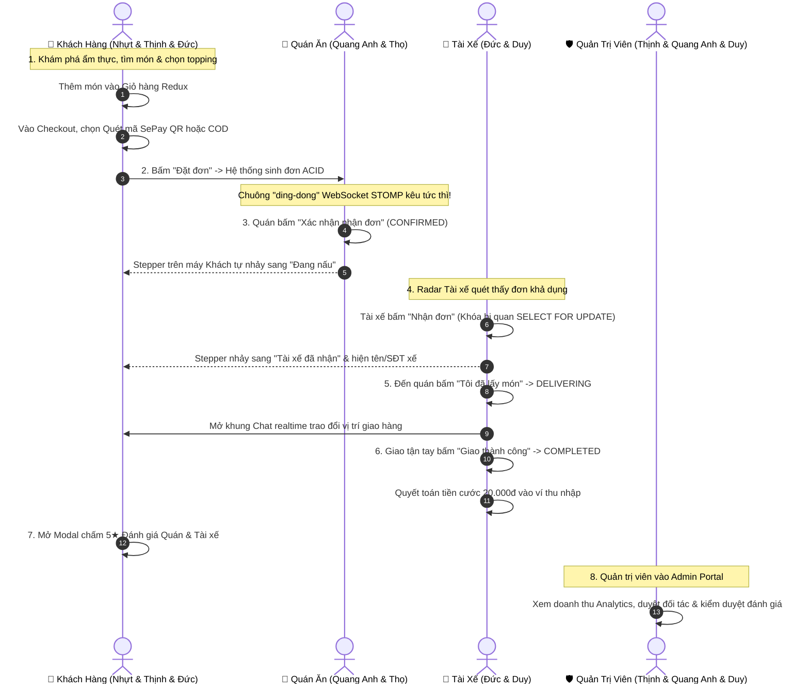

# 📋 BÁO CÁO CÁC MODULE TÍNH NĂNG THEO THÀNH VIÊN (DEMO ĐỒ ÁN OJT)
## DỰ ÁN: FOOD THUNDER DELI - HỆ THỐNG ĐẶT & GIAO ĐỒ ĂN TRỰC TUYẾN
> **Kiến trúc hệ thống:** Spring Boot 3 Microservices + React 19 TypeScript + MySQL 8.0 (Decoupled Schema) + WebSocket STOMP + Docker Compose  
> **Phương pháp quản lý:** Agile / Scrum trên [Trello Backlog Plan](file:///d:/ojt-food-deli-start/TRELLO_BACKLOG_PLAN.md) & [Planning Sprint 4](file:///d:/ojt-food-deli-start/document/Planning-sprint4.md)  
> **Tổng quy mô dự án:** 180+ Story Points | 10 Microservices | 13 Containers Docker Production  
> **Đội ngũ phát triển (6 thành viên):** Nguyễn Tá Thọ (Leader), Trần Hoàng Duy, Nguyễn Quang Anh, Nguyễn Tuấn Nhựt, Phan Lê Duy Thịnh, Trần Minh Đức  
> **Ghi chú quản lý nhánh & Merge:** Báo cáo chỉ ghi nhận **100% các tính năng đã hoàn thành và đã được MERGE** vào nhánh chính. Các task Sprint 4 của **Phan Lê Duy Thịnh** (THINH-01, THINH-02, THINH-03 đang ở *In Review*) và **Trần Minh Đức** (DUC-01, DUC-03 đang ở *In Progress/Todo*) **chưa được merge nên không đưa vào báo cáo này**.

---

## 👥 I. TỔNG QUAN PHÂN BỔ NHÂN SỰ & MA TRẬN ĐÓNG GÓP (TEAM MATRIX)

| STT | Thành Viên | Vai Trò Chính | Phân Hệ / Module Phụ Trách Đã Merge | Tổng Story Points Đã Merge | Tỷ Trọng Đóng Góp |
| :---: | :--- | :--- | :--- | :---: | :---: |
| 1 | **Nguyễn Tá Thọ** | **Leader & Architect / DevOps** | • Hạ tầng Microservices Hub, API Gateway JWT, Eureka, Config Server<br>• Cổng thanh toán trực tuyến SePay Gateway (`payment-service`)<br>• Hạ tầng Realtime WebSocket STOMP Hub (`chat-notification-service`)<br>• Chuẩn hóa STOMP Gateway, kịch bản E2E & Docker Production (Sprint 4) | **43 SP** | 23.4% |
| 2 | **Trần Hoàng Duy** | **Backend Core Engineer** | • Phân hệ Đơn hàng (`order-service`): Transaction ACID & State Machine<br>• Phân hệ Vận chuyển (`delivery-service`): Khóa bi quan `SELECT FOR UPDATE`<br>• Thuật toán Hiệu suất AR/CR & Analytics Dashboard<br>• **Sprint 4:** Ràng buộc 60s hủy đơn (BUG-01), sửa thu nhập ví xế (BUG-02), khóa bi quan trả đơn (BUG-09) | **30 SP** | 16.3% |
| 3 | **Nguyễn Quang Anh**| **Backend / Fullstack Merchant** | • Phân hệ Quán ăn & Thực đơn (`restaurant-service`)<br>• Cổng Quản lý Đối tác (Merchant Portal): Multi-shop, Menu, Topping, Voucher<br>• Cổng Phê duyệt Quán ăn & Tài xế mới (`/admin/approvals`)<br>• **Sprint 4:** Chống thất thoát Voucher `usageLimit` (BUG-03), chặn IDOR thực đơn (BUG-05), fix rò rỉ chi nhánh (BUG-06) | **31 SP** | 16.8% |
| 4 | **Nguyễn Tuấn Nhựt** | **Frontend Core Engineer** | • Định danh tập trung Unified Auth (`/login`, `/register`) & Dynamic Role Nav<br>• Tuyến phòng thủ Route Guard `<ProtectedRoute>` bảo vệ Checkout<br>• Màn hình Lịch sử Đơn hàng (`/orders`) & Live Tracking Stepper 5 bước<br>• Widget Khung Chat Realtime 2 chiều Khách $\leftrightarrow$ Quán / Xế<br>• **Sprint 4:** Ràng buộc đơn quán Cart UI (BUG-04), đếm ngược 60s hủy đơn, tối ưu Chat Read Receipts | **30 SP** | 16.3% |
| 5 | **Phan Lê Duy Thịnh**| **Frontend / Admin Specialist** | • Trang chủ Khám phá Ẩm thực (Home UI, Debounce Search, Category Filter)<br>• Trang Chi tiết Quán & Thực đơn (`/restaurants/:id`) kèm Modal Topping<br>• Phân hệ Đánh giá 5★ (`review-service`) cho Quán & Tài xế<br>• Admin Portal: Quản lý User (`/admin/users`), Quản trị Đánh giá (`/admin/reviews`)<br>*(Giữ nguyên các task đã merge; các task Banner THINH-01, Tham số THINH-02, Perf THINH-03 đang In Review nên không đưa vào)* | **25 SP** | 13.6% |
| 6 | **Trần Minh Đức** | **Frontend Portals Specialist** | • Giỏ hàng tập trung Redux Toolkit & Checkout đa phương thức (COD / SePay QR)<br>• Bộ chọn Đa Chi nhánh (Branch Switcher) cho Merchant nhiều quán<br>• Cổng Làm Việc Tài Xế (Shipper Web Hub `/shipper`): Radar đơn 1-chạm, Single Active Order, Điều hướng Giao hàng Ảo hóa, Lịch sử cuốc xe<br>*(Giữ nguyên các task đã merge; task Ví Driver DUC-01 và Hủy đơn FE DUC-03 đang In Progress nên không đưa vào)* | **25 SP** | 13.6% |
| **Σ** | **CẢ NHÓM 6 NGƯỜI** | **Thunder Food Delivery Team** | **Toàn bộ tính năng đã Merge vào Main - Sẵn sàng Demo OJT** | **184 SP** | **100%** |

---

## 🔍 II. CHI TIẾT MODULE & TÍNH NĂNG CỦA TỪNG THÀNH VIÊN

---

### 1. NGUYỄN TÁ THỌ (LEADER - SYSTEM ARCHITECT & DEVOPS / PAYMENT)
> **Mục tiêu cốt lõi:** Xây dựng toàn bộ khung xương sống phân tán (Backbone Architecture), cổng thanh toán tự động SePay qua quét mã QR ngân hàng, hạ tầng sự kiện thời gian thực STOMP, tối ưu Gateway Sprint 4 và đóng gói vận hành hệ thống.

#### A. Các Module & Tính Năng Đã Thực Hiện:
1. **Kiến Trúc Microservices Hub & API Gateway (Port 8080):**
   - Thiết lập cụm dịch vụ trung tâm: `discovery-service` (Eureka Port 8761), `config-server` (Port 8888) và `api-gateway` (Port 8080).
   - Xây dựng [JwtAuthenticationFilter.java](file:///d:/ojt-food-deli-start/food-deli-service/api-gateway/src/main/java/com/foodthunder/gateway/filter/JwtAuthenticationFilter.java): Kiểm tra tính hợp lệ của JWT token, trích xuất Claims và tiêm danh tính phân tán (`X-User-Id`, `X-User-Role`, `X-User-Email`) chuyển tiếp xuống các service nghiệp vụ.
   - Định tuyến tập trung toàn bộ endpoint `/api/v1/...` và thiết lập CORS Filter toàn cục.
2. **Cổng Thanh Toán Trực Tuyến Tự Động SePay Gateway (`payment-service` Port 8085):**
   - Tích hợp cổng thanh toán trực tuyến **SePay (`sepay.vn`)**: Tự động hóa chuyển khoản ngân hàng không thu phí giao dịch phức tạp, tiền vào trực tiếp tài khoản sàn ngay lập tức (Realtime $0$ giây).
   - Thiết lập **Cú pháp định danh nội dung chuyển khoản duy nhất**:
     $$\mathbf{FOODDELI \quad ORD\{orderId\}}$$
   - Lập trình thuật toán sinh mã QR SePay động chuẩn ngân hàng: Tự động nhúng số tiền đơn hàng, thông tin tài khoản thụ hưởng và mã nội dung đơn hàng định danh duy nhất.
   - Endpoint `POST /api/v1/payments/sepay/generate` sinh payload mã QR SePay động kèm thời gian hết hạn (Countdown Timer).
   - **Tích hợp SePay Webhook IPN (`POST /api/v1/payments/sepay/webhook`):** Tự động tiếp nhận thông báo biến động số dư từ SePay ngay khi khách chuyển khoản thành công $\rightarrow$ Xác thực API Key / Header bảo mật $\rightarrow$ Cập nhật tức thì trạng thái đơn hàng sang `PAID` và chuyển đơn sang `PENDING` cho Quán chuẩn bị.
   - Cung cấp API Polling tra cứu trạng thái giao dịch: `GET /api/v1/payments/orders/{orderId}/status` phục vụ Modal thanh toán kiểm tra tự động.
3. **Hạ Tầng Realtime WebSocket STOMP Hub (`chat-notification-service` Port 8087):**
   - Cấu hình Spring WebSocket STOMP endpoint `/ws-food-deli`, kênh phân phối `/topic` và tiền tố `/app`.
   - Thiết lập cơ chế phát sóng sự kiện tức thì: Khi đơn hàng được xác nhận thanh toán qua SePay (hoặc tạo đơn COD) $\rightarrow$ Broadcast sự kiện `ORDER_CREATED` đến kênh `/topic/merchant/{shopId}/orders`.
   - Kết nối âm thanh chuông báo "ding-dong" tức thì trên màn hình Merchant Dashboard và Shipper Hub.
4. **Nhiệm Vụ Trọng Tâm Sprint 4 (THO-01, THO-02, THO-03 - 10 SP):**
   - **Task THO-01:** Chuẩn hóa và cố định kiến trúc WebSocket STOMP qua API Gateway: Đảm bảo route `/ws` và `/ws-food-deli` luôn trỏ trực tiếp sang `chat-notification-service` (`lb://chat-notification-service`), loại bỏ triệt để xung đột socket cũ ở `order-service`, tối ưu độ trễ nhận message và chuông báo dưới 50ms.
   - **Task THO-02:** Thiết lập kịch bản kiểm thử liên thông 4 vai trò (Cross-Role E2E Orchestration) trên 4 màn hình song song.
   - **Task THO-03:** Đóng gói Docker Compose Production, tối ưu JVM Heap (`-Xmx`), chuẩn hóa 100% dữ liệu seed [database/seed_all.sql](file:///d:/ojt-food-deli-start/database/seed_all.sql) sang tiếng Việt UTF-8.

#### B. Thẻ Trello & Sprint 4 Phụ Trách:
- `SP1-1.1`, `SP1-1.2`, `SP1-1.9`: Khởi tạo Hub Microservices, Auth JWT & Gateway (13 SP).
- `SP2-CORE-01`: Cổng thanh toán quét mã SePay QR động & Webhook tự động (5 SP).
- `SP2-CORE-02`: Thiết lập Realtime WebSocket STOMP Hub & Chuông báo quán ăn (4 SP).
- `SP3-FIX-MERCH-02`: Chuông báo WebSocket STOMP & Doanh thu đa quán (4 SP).
- `SP3-OPS-01`: Đóng gói Docker Compose Production & Nghiệm thu (7 SP).
- `THO-01`, `THO-02`, `THO-03` (Sprint 4): Chuẩn hóa STOMP Gateway, kịch bản E2E & Docker Production (10 SP).
- **Tổng cộng: 43 SP**

#### C. Bằng Chứng Mã Nguồn & Vị Trí Demo:
- Gateway: [JwtAuthenticationFilter.java](file:///d:/ojt-food-deli-start/food-deli-service/api-gateway/src/main/java/com/foodthunder/gateway/filter/JwtAuthenticationFilter.java)
- Cổng SePay Gateway: [PaymentServiceImpl.java](file:///d:/ojt-food-deli-start/food-deli-service/payment-service/src/main/java/com/foodthunder/payment/service/impl/PaymentServiceImpl.java) & [PaymentController.java](file:///d:/ojt-food-deli-start/food-deli-service/payment-service/src/main/java/com/foodthunder/payment/controller/PaymentController.java)
- WebSocket Config: [WebSocketConfig.java](file:///d:/ojt-food-deli-start/food-deli-service/chat-notification-service/src/main/java/com/foodthunder/chat/config/WebSocketConfig.java)
- Docker Compose: [docker-compose.yml](file:///d:/ojt-food-deli-start/food-deli-service/docker-compose.yml)

---

### 2. TRẦN HOÀNG DUY (BACKEND CORE ENGINEER - DELIVERY & ORDER SERVICE)
> **Mục tiêu cốt lõi:** Lập trình xử lý giao dịch đơn hàng ACID, State Machine quản lý vòng đời đơn, giải quyết bài toán chống xung đột Race Condition khi tài xế tranh nhận đơn và hoàn thiện toàn bộ các logic vá lỗi trọng tâm Sprint 4.

#### A. Các Module & Tính Năng Đã Thực Hiện:
1. **Phân Hệ Đơn Hàng Lõi (`order-service` Port 8083):**
   - Thiết kế các Entity cốt lõi: `Order`, `OrderItem`, `OrderItemTopping`, `OrderStatus`, `OrderStatusLog`.
   - Áp dụng **Data Snapshot Pattern**: Lưu vết bất biến địa chỉ nhận hàng, số điện thoại, tên món và đơn giá tại thời điểm đặt đơn (`price_at_order`).
   - Xử lý API `POST /api/v1/orders` trong Transaction ACID, kiểm tra dữ liệu giỏ hàng, tính tổng tiền, chiết khấu voucher sàn/quán và lưu trạng thái khởi tạo `PENDING` (hoặc `AWAITING_PAYMENT` nếu chọn thanh toán SePay).
   - Xây dựng cỗ máy trạng thái (Order State Machine) 6 bước nghiêm ngặt:
     $$\text{PENDING} \longrightarrow \text{CONFIRMED} \longrightarrow \text{DRIVER\_ACCEPTED} \longrightarrow \text{PICKING\_UP} \longrightarrow \text{DELIVERING} \longrightarrow \text{COMPLETED}$$
2. **Phân Hệ Vận Chuyển & Khóa Bi Quan (`delivery-service` Port 8084):**
   - Quản lý các thực thể: `DriverDetail`, `DriverLocation`, `DriverOffer`, `DriverPenalty`.
   - **Giải quyết triệt để Race Condition khi nhận đơn:** Áp dụng **Pessimistic Locking (`SELECT ... FOR UPDATE`)** trong phương thức `acceptOrder(Long driverId, Long orderId)` với mức cô lập giao dịch cao nhất. Đảm bảo khi 2 hoặc nhiều tài xế cùng bấm nhận 1 cuốc xe tại cùng một mili-giây, chỉ có 1 tài xế nhận thành công, các tài xế còn lại nhận lỗi thân thiện `409 Conflict`.
   - Quy định phân quyền trạng thái: Quán ăn tuyệt đối không được bấm `COMPLETED`; Tài xế là người duy nhất có quyền bấm `DELIVERING` (đã lấy món) và `COMPLETED` (sau khi giao tận tay khách).
3. **Bộ Máy Tính Hiệu Suất Tài Xế Chuẩn PRD (AR / CR Metrics):**
   - Lập trình thuật toán đo lường hiệu suất tài xế trên rolling window 100 đơn gần nhất theo đúng tài liệu đặc tả [DRIVER_PERFORMANCE_PRD.md](file:///d:/ojt-food-deli-start/DRIVER_PERFORMANCE_PRD.md):
     $$AR = \frac{\text{Offers Accepted}}{\text{Total Offers}} \times 100\% \quad ; \quad CR = \frac{\text{Orders Cancelled by Driver}}{\text{Orders Accepted}} \times 100\%$$
   - Tự động áp dụng chế tài cảnh báo và tạm khóa tài xế nếu $AR < 80\%$ hoặc $CR > 10\%$.
4. **Nhiệm Vụ Trọng Tâm Sprint 4 Đã Triển Khai (DUY-01, DUY-02, DUY-03 - 9 SP):**
   - **Task DUY-01 (Fix BUG-02 - Cập nhật COMPLETED & Thu nhập tài xế):** Trong `DeliveryServiceImpl.updateDeliveryStep`, khi `targetStep = "COMPLETED"`, cập nhật chính xác `offer.setStatus("COMPLETED")` và `offer.setDeliveredAt(LocalDateTime.now())`. Sửa hàm `getDriverMetrics` chỉ tính thu nhập tiền ship 20.000đ khi cuốc xe có trạng thái `COMPLETED` (loại bỏ việc tính khống khi mới `ACCEPTED`).
   - **Task DUY-02 (Fix BUG-01 - RBAC & Ràng buộc 60s Hủy Đơn Khách Hàng):** Cập nhật `OrderServiceImpl.cancelOrder`:
     - Nếu người gọi là `CUSTOMER`: Chỉ cho phép hủy khi đơn còn `PENDING` hoặc `AWAITING_PAYMENT`. Nếu quán đã xác nhận (`CONFIRMED`) hoặc đã có tài xế nhận, lập tức ném lỗi chặn: *"Đơn hàng đã được quán nấu hoặc tài xế đang giao, không thể hủy!"*.
     - Ràng buộc thời gian: Nếu thời gian tạo đơn vượt quá 60 giây, từ chối hủy.
   - **Task DUY-03 (Fix BUG-09 - Khóa bi quan luồng Tài xế trả đơn):** Bổ sung khóa bi quan `SELECT ... FOR UPDATE` cho luồng tài xế hủy nhận cuốc trong `DeliveryServiceImpl.cancelOrder`, ngăn ngừa Deadlock và Race Condition khi tài xế vừa trả cuốc thì có tài xế khác nhận lại.

#### B. Thẻ Trello & Sprint 4 Phụ Trách:
- `SP1-1.4`: Backend `order-service` giỏ hàng & State Machine (5 SP).
- `SP2-CUST-09`: Hoàn thiện lõi Backend `order-service` ACID (4 SP).
- `SP2-MERCH-06`: Backend API hỗ trợ Topping, Danh mục & Voucher Quán (4 SP).
- `SP3-DRV-01`: Backend `delivery-service` & Khóa bi quan chống Race Condition (5 SP).
- `SP3-DRV-02`: Thuật toán Hiệu suất Tài xế AR/CR chuẩn PRD (3 SP).
- `SP4-DUY-01`: Fix BUG-02 cập nhật COMPLETED và thu nhập ví xế (3 SP).
- `SP4-DUY-02`: Fix BUG-01 ràng buộc 60s hủy đơn & RBAC trạng thái (3 SP).
- `SP4-DUY-03`: Fix BUG-09 khóa bi quan luồng tài xế trả đơn (3 SP).
- **Tổng cộng: 30 SP**

#### C. Bằng Chứng Mã Nguồn & Vị Trí Demo:
- Xử lý đơn hàng & Chặn hủy 60s: [OrderServiceImpl.java](file:///d:/ojt-food-deli-start/food-deli-service/order-service/src/main/java/com/foodthunder/order/service/OrderServiceImpl.java)
- Khóa bi quan Concurrency: [DeliveryServiceImpl.java](file:///d:/ojt-food-deli-start/food-deli-service/delivery-service/src/main/java/com/foodthunder/delivery/service/impl/DeliveryServiceImpl.java#L45-L85)
- Repository Khóa `FOR UPDATE`: [DriverOfferRepository.java](file:///d:/ojt-food-deli-start/food-deli-service/delivery-service/src/main/java/com/foodthunder/delivery/repository/DriverOfferRepository.java)

---

### 3. NGUYỄN QUANG ANH (BACKEND / FULLSTACK MERCHANT SPECIALIST)
> **Mục tiêu cốt lõi:** Xây dựng toàn bộ phân hệ quản lý đối tác Quán ăn (`restaurant-service`), cổng quản lý thực đơn, topping, voucher quán, quy trình phê duyệt đối tác và hoàn thiện các cơ chế bảo mật phân quyền Sprint 4.

#### A. Các Module & Tính Năng Đã Thực Hiện:
1. **Phân Hệ Thực Đơn & Quán Ăn (`restaurant-service` Port 8082):**
   - Thiết kế các Entity: `Restaurant`, `RestaurantChangeRequest`, `Category`, `FoodItem`, `Topping`, `FoodTopping`, `Voucher`.
   - Hỗ trợ mô hình sở hữu đa chi nhánh: 1 tài khoản Merchant sở hữu nhiều quán ăn qua API `GET /api/v1/restaurants/mine`.
   - Xây dựng hệ thống CRUD Món ăn, danh mục menu và upload hình ảnh món ăn.
   - Nút gạt chuyển đổi trạng thái **Còn hàng / Hết hàng** tức thì (`PUT /api/v1/products/{id}/status`), đồng bộ ngay lập tức không cho khách đặt món khi hết hàng.
2. **Hệ Thống Quản Lý Topping Nâng Cao & Gán Vào Món:**
   - Xây dựng tính năng quản lý danh sách Topping (Size, Trân châu, Trứng ốp la, Phô mai...) kèm giá tiền tương ứng.
   - Tính năng **Gán Topping vào món ăn cụ thể** (`food_toppings`): Cho phép chủ quán cấu hình mỗi món ăn chỉ được chọn các topping phù hợp (ví dụ: Trà sữa chọn trân châu, Cơm sườn chọn trứng ốp la).
   - Hỗ trợ cả 2 định dạng API: Chuẩn Monolith legacy `GET /api/v1/foods/{id}/toppings` và Chuẩn Microservice `GET /api/v1/toppings?restaurantId={id}`.
3. **Merchant Dashboard & Quản Lý Đơn Hàng Quán Ăn:**
   - Màn hình [MerchantDashboardPage.tsx](file:///d:/ojt-food-deli-start/food-deli-client/src/pages/merchant/MerchantDashboardPage.tsx): Tiếp nhận đơn hàng đổ về từ khách, phân chia tab trực quan (`Đơn mới`, `Đang nấu`, `Hoàn thành`, `Đã hủy`).
   - Thao tác 1-chạm: Nút **"Xác nhận nhận đơn"** (`CONFIRMED`) để chuyển nhà bếp nấu món, hoặc **"Từ chối đơn / Báo hết món"** (`CANCELLED`) kèm lý do rõ ràng.
   - Xem chi tiết đơn: Danh sách món, số lượng, topping đi kèm, ghi chú riêng của khách hàng.
4. **Cổng Phê Duyệt Đối Tác Mới (`/admin/approvals`):**
   - Màn hình [AdminApprovalPage.tsx](file:///d:/ojt-food-deli-start/food-deli-client/src/pages/admin/AdminApprovalPage.tsx): Xem danh sách yêu cầu đăng ký mở quán ăn mới (`restaurant_change_requests`) và đăng ký tài xế mới (`driver_details` PENDING).
   - Thao tác "Phê duyệt" (APPROVED) hoặc "Từ chối" (REJECTED) kèm lý do phản hồi cho đối tác.
5. **Nhiệm Vụ Trọng Tâm Sprint 4 Đã Triển Khai (QA-01, QA-02, QA-03 - 8 SP):**
   - **Task QA-01 (Fix BUG-03 - Chống Thất Thoát Lượt Dùng Voucher `usageLimit`):** Xây dựng API nội bộ `PUT /api/v1/vouchers/{id}/redeem` trong `restaurant-service` tự động tăng `usedCount` lên 1 và tự động vô hiệu hóa mã khi chạm mốc `usageLimit`, gọi trực tiếp từ `OrderServiceImpl` khi tạo đơn thành công.
   - **Task QA-02 (Fix BUG-05 - Chặn Lỗ Hổng IDOR Trên Thực Đơn Quán Ăn):** Trong `ProductController`, `CategoryController`, `ToppingController`, bổ sung xác thực quyền sở hữu: Kiểm tra `X-User-Id` của Merchant có đúng là chủ sở hữu của `restaurantId` hay không trước khi thực hiện `POST`, `PUT`, `DELETE`. Chặn đứng nguy cơ Quán A can thiệp món của Quán B (trả về `403 Forbidden`).
   - **Task QA-03 (Fix BUG-06 - Loại Bỏ Fallback `ownerId = 3`):** Xử lý trong `RestaurantController.getMyRestaurants`: Nếu `headerOwnerId` null và không có danh tính hợp lệ truyền vào, ném ngay `UnauthorizedException` (401) thay vì gán mặc định bằng 3, ngăn chặn rò rỉ danh sách chi nhánh quán.

#### B. Thẻ Trello & Sprint 4 Phụ Trách:
- `SP1-1.3`, `SP1-1.8`: Backend `restaurant-service` & Màn hình nhận đơn MVP (10 SP).
- `SP2-MERCH-03`: Merchant Dashboard tiếp nhận & xử lý đơn Realtime (3 SP).
- `SP2-MERCH-04`: Quản lý Thực đơn & Món ăn (Menu & Product CRUD) (3 SP).
- `SP2-MERCH-05`: Quản lý Nhóm Topping & Gán Topping vào món (3 SP).
- `SP2-MERCH-07`: Giao diện Danh mục món & Voucher khuyến mãi quán (2 SP).
- `SP3-ADM-02`: Admin Portal phê duyệt Quán & Tài xế mới (2 SP).
- `SP4-QA-01`: Fix BUG-03 chống thất thoát lượt dùng Voucher `usageLimit` (3 SP).
- `SP4-QA-02`: Fix BUG-05 chặn lỗ hổng IDOR trên thực đơn quán (3 SP).
- `SP4-QA-03`: Fix BUG-06 loại bỏ fallback `ownerId = 3` làm rò rỉ chi nhánh (2 SP).
- **Tổng cộng: 31 SP**

#### C. Bằng Chứng Mã Nguồn & Vị Trí Demo:
- Backend: [RestaurantController.java](file:///d:/ojt-food-deli-start/food-deli-service/restaurant-service/src/main/java/com/foodthunder/restaurant/controller/RestaurantController.java) & [ToppingController.java](file:///d:/ojt-food-deli-start/food-deli-service/restaurant-service/src/main/java/com/foodthunder/restaurant/controller/ToppingController.java)
- Dashboard Quán: [MerchantDashboardPage.tsx](file:///d:/ojt-food-deli-start/food-deli-client/src/pages/merchant/MerchantDashboardPage.tsx)
- Quản lý Thực đơn: [MerchantMenuPage.tsx](file:///d:/ojt-food-deli-start/food-deli-client/src/pages/merchant/MerchantMenuPage.tsx)
- Phê duyệt Admin: [AdminApprovalPage.tsx](file:///d:/ojt-food-deli-start/food-deli-client/src/pages/admin/AdminApprovalPage.tsx)

---

### 4. NGUYỄN TUẤN NHỰT (FRONTEND CORE ENGINEER - CUSTOMER EXPERIENCE & REALTIME CHAT)
> **Mục tiêu cốt lõi:** Xây dựng hệ thống định danh tập trung (Unified Auth), bảo vệ tuyến đường bằng Route Guard, màn hình lịch sử đơn hàng, cỗ máy theo dõi tiến trình đơn thời gian thực và hoàn thiện các cải tiến trải nghiệm khách hàng Sprint 4.

#### A. Các Module & Tính Năng Đã Thực Hiện:
1. **Hệ Thống Định Danh Tập Trung (Unified Auth) & Dynamic Navigation Header:**
   - Tuân thủ nguyên tắc cốt lõi: **Duy nhất 1 trang Đăng nhập (`/login`) và 1 trang Đăng ký (`/register`)** dùng chung cho tất cả các đối tượng (Khách hàng, Quán ăn, Tài xế, Quản trị viên).
   - Thanh Header điều hướng thích ứng theo vai trò (`role` trong JWT token):
     - `ROLE_CUSTOMER`: Xem thông tin cá nhân, Lịch sử đơn hàng (`/orders`), Giỏ hàng.
     - `ROLE_MERCHANT`: Hiển thị nút truy cập nhanh *"Quán ăn của tôi (Merchant Portal)"*.
     - `ROLE_DRIVER`: Hiển thị nút truy cập nhanh *"Cổng làm việc Tài xế (Shipper Hub)"*.
     - `ROLE_ADMIN`: Hiển thị nút truy cập nhanh *"Trang Quản trị Hệ thống (Admin Portal)"*.
2. **Tuyến Phòng Thủ Route Guard Bảo Vệ Thanh Toán:**
   - Xây dựng component `<ProtectedRoute>` bọc toàn bộ các tuyến đường nhạy cảm (`/checkout`, `/orders`, `/merchant/**`, `/shipper/**`, `/admin/**`).
   - Khi khách vãng lai (Anonymous) bấm tiến hành đặt hàng tại giỏ hàng $\rightarrow$ Tự động cảnh báo và điều hướng sang `/login` kèm `state: { from: '/checkout' }`.
   - Ngay sau khi đăng nhập thành công $\rightarrow$ Hệ thống tự động chuyển hướng quay trở lại đúng trang `/checkout` để khách tiếp tục thanh toán mà không làm mất giỏ hàng.
3. **Màn Hình Lịch Sử Đơn Hàng Của Khách Hàng (`/orders`):**
   - Màn hình [OrderHistoryPage.tsx](file:///d:/ojt-food-deli-start/food-deli-client/src/pages/user/order/OrderHistoryPage.tsx): Hiển thị toàn bộ các đơn hàng đã đặt kèm mã đơn, thời gian, tên quán, tổng tiền, phương thức thanh toán (COD hoặc SePay) và trạng thái hiện tại.
   - Bấm vào đơn hàng để mở xem chi tiết từng món ăn, danh sách topping đã chọn, địa chỉ giao hàng và nút điều hướng sang trang Live Tracking.
4. **Màn Hình Theo Dõi Đơn Hàng Thời Gian Thực (Live Stepper 5 Bước - `/orders/:id`):**
   - Xây dựng component [OrderDetailPage.tsx](file:///d:/ojt-food-deli-start/food-deli-client/src/pages/user/order/OrderDetailPage.tsx) và Stepper 5 bước:
     $$\text{Chờ xác nhận} \longrightarrow \text{Đang nấu} \longrightarrow \text{Tài xế đã nhận} \longrightarrow \text{Đang giao hàng} \longrightarrow \text{Đã giao thành công}$$
   - Lắng nghe kênh WebSocket STOMP `/topic/orders/{orderId}`: Khi Quán bấm nhận đơn hoặc Tài xế cập nhật tiến trình cuốc xe $\rightarrow$ Stepper trên màn hình khách hàng tự động nhảy mốc thời gian thực mà **không cần bấm F5 tải lại trang**.
   - Hiển thị tên và số điện thoại của tài xế khi đơn có tài xế nhận.
5. **Nhiệm Vụ Trọng Tâm Sprint 4 Đã Triển Khai (NHUT-01, NHUT-02, NHUT-03 - 8 SP):**
   - **Task NHUT-01 (Fix BUG-04 - Ràng buộc Đơn Quán trên Cart UI & Checkout):** Nhóm danh sách món ăn theo từng Quán ăn (Group by Restaurant). Khi khách hàng chọn món từ Quán A, hệ thống tự động vô hiệu hóa (disable) checkbox chọn món của Quán B kèm Tooltip giải thích: *"Mỗi đơn hàng chỉ được đặt món từ 1 quán ăn duy nhất"*, ngăn chặn triệt để lỗi xung đột khi bấm sang Checkout.
   - **Task NHUT-02 (Đồng hồ đếm ngược 60s Hủy Đơn trên `OrderDetailPage.tsx`):** Khi đơn hàng ở trạng thái `PENDING`, hiển thị đồng hồ đếm ngược trực quan: *"Bạn có thể hủy đơn trong: XX giây"*. Sau 60 giây hoặc khi quán đã bấm `CONFIRMED`, nút Hủy đơn sẽ tự động ẩn đi, đồng bộ hoàn hảo với logic Backend.
   - **Task NHUT-03 (Tối ưu Realtime Chat Widget):** Tối ưu component [ShopeeStyleChatDrawer.tsx](file:///d:/ojt-food-deli-start/food-deli-client/src/components/chat/ShopeeStyleChatDrawer.tsx): Bổ sung trạng thái Đã xem (Read receipts), đồng bộ Unread Count trên Chat Floating Pill, đảm bảo chat 2 chiều giữa Khách $\leftrightarrow$ Quán / Xế hiển thị tức thì và mượt mà.

#### B. Thẻ Trello & Sprint 4 Phụ Trách:
- `SP1-1.5`: Form Auth & Redux lưu trữ Token (5 SP).
- `SP2-CUST-05`: Nâng cấp Header Navigation theo Role & Đăng nhập tập trung (2 SP).
- `SP2-CUST-06`: Bọc Route Guard cho Checkout & Chuyển hướng Login (2 SP).
- `SP2-CUST-07`: Xây dựng trang Lịch sử đơn hàng của khách hàng (`/orders`) (3 SP).
- `SP3-FIX-ADM-01`: Sửa form duyệt & Hiển thị Tag "Không có tài xế" (3 SP).
- `SP3-LIVE-01`: Màn hình theo dõi đơn hàng thời gian thực 5 bước (4 SP).
- `SP3-LIVE-02`: Widget Chat trực tiếp 2 chiều Khách $\leftrightarrow$ Quán / Xế (3 SP).
- `SP4-NHUT-01`: Fix BUG-04 ràng buộc đơn quán trên Cart UI & Checkout (3 SP).
- `SP4-NHUT-02`: Đồng hồ đếm ngược 60s hủy đơn trên OrderDetailPage (2 SP).
- `SP4-NHUT-03`: Tối ưu trải nghiệm Realtime Chat Widget & Read Receipts (3 SP).
- **Tổng cộng: 30 SP**

#### C. Bằng Chứng Mã Nguồn & Vị Trí Demo:
- Route Guard & Navigation: [routes/index.tsx](file:///d:/ojt-food-deli-start/food-deli-client/src/routes/index.tsx) & [Header.tsx](file:///d:/ojt-food-deli-start/food-deli-client/src/components/layout/Header.tsx)
- Lịch sử đơn & Countdown 60s: [OrderDetailPage.tsx](file:///d:/ojt-food-deli-start/food-deli-client/src/pages/user/order/OrderDetailPage.tsx)
- Giỏ hàng ràng buộc đơn quán: [CartPage.tsx](file:///d:/ojt-food-deli-start/food-deli-client/src/pages/user/cart/CartPage.tsx)
- Widget Chat: [ShopeeStyleChatDrawer.tsx](file:///d:/ojt-food-deli-start/food-deli-client/src/components/chat/ShopeeStyleChatDrawer.tsx)

---

### 5. PHAN LÊ DUY THỊNH (FRONTEND / UI-UX & ADMIN SPECIALIST)
> **Mục tiêu cốt lõi:** Thiết kế giao diện khám phá ẩm thực chuẩn ShopeeFood/GrabFood, trang chi tiết quán ăn kèm modal tùy biến topping, phân hệ đánh giá 5 sao độc lập và các màn hình quản trị Admin Portal.
> **Lưu ý kiểm soát nhánh Merge:** Các task Sprint 4 gồm `THINH-01` (Quản lý Banner động), `THINH-02` (Quản lý tham số toàn hệ thống) và `THINH-03` (Cải thiện Performance Ant Design) hiện đang ở trạng thái **`In Review`**, **chưa được merge vào nhánh chính nên không đưa vào báo cáo này**.

#### A. Các Module & Tính Năng Đã Hoàn Thành & Đã Merge:
1. **Trang Chủ Khám Phá Ẩm Thực (Home UI Redesign & Data Thật):**
   - Thiết kế lại toàn bộ giao diện [HomePage.tsx](file:///d:/ojt-food-deli-start/food-deli-client/src/pages/user/home/HomePage.tsx) đạt chuẩn thẩm mỹ cao: Hero Banner trượt bắt mắt, lưới Card quán ăn/món ăn nổi bật, huy hiệu điểm sao và thời gian chuẩn bị.
   - **Thanh lọc Danh mục Ẩm thực (Category Bar):** Cuộn ngang danh mục (Cơm tấm, Bún/Phở, Trà sữa, Pizza, Gà rán...), bấm vào tự động lọc các quán ăn có danh mục tương ứng.
   - **Tìm kiếm Debounce Search 300ms:** Người dùng gõ từ khóa tìm kiếm tên quán hoặc món ăn $\rightarrow$ Tự động lọc mượt mà sau 300ms mà không bị giật lag giao diện.
   - Xóa bỏ hoàn toàn mảng tĩnh giả lập, kết nối API thật `restaurantApi.getAll()` lấy dữ liệu từ MySQL qua Gateway.
2. **Trang Chi Tiết Quán Ăn & Thực Đơn (`/restaurants/:id`):**
   - Xây dựng giao diện [RestaurantDetailPage.tsx](file:///d:/ojt-food-deli-start/food-deli-client/src/pages/user/restaurant/RestaurantDetailPage.tsx): Hiển thị thông tin quán, địa chỉ, giờ hoạt động, số sao đánh giá và thực đơn phân theo từng nhóm danh mục.
   - **Modal Tùy Biến Topping Tính Tiền Realtime:** Bấm vào món ăn mở popup chọn Size, Độ ngọt, Đá và các Topping ăn kèm $\rightarrow$ Tổng tiền nhảy theo thời gian thực trước khi người dùng xác nhận bấm "Thêm vào giỏ".
3. **Phân Hệ Đánh Giá 5★ Riêng Quán Ăn & Tài Xế (`review-service` Port 8086):**
   - Xây dựng 2 Modal đánh giá riêng biệt sau khi đơn hàng hoàn tất (`COMPLETED`):
     - Modal Đánh giá Quán ăn: Chấm từ 1 đến 5 sao, chọn món ăn tâm đắc trong đơn và viết lời bình luận.
     - Modal Đánh giá Tài xế: Chấm sao, đính kèm các thẻ nhận xét nhanh (Quick Tags: *Giao nhanh, Thân thiện, Nhiệt tình...*).
   - Tự động tính toán và hiển thị điểm sao trung bình (`ratingAvg`) của từng Quán ăn và Tài xế.
4. **Cổng Quản Trị Hệ Thống (Admin Portal - Các Trang Đã Merge):**
   - Màn hình Quản trị Người Dùng ([AdminUserPage.tsx](file:///d:/ojt-food-deli-start/food-deli-client/src/pages/admin/AdminUserPage.tsx)): Xem danh sách phân trang, tìm kiếm, lọc vai trò, Thêm người dùng mới, Sửa thông tin, Khóa/Mở khóa tài khoản vi phạm.
   - Màn hình Quản trị Đánh giá ([AdminReviewManagementPage.tsx](file:///d:/ojt-food-deli-start/food-deli-client/src/pages/admin/AdminReviewManagementPage.tsx)): Tách riêng 2 tab quản lý đánh giá Quán ăn và Tài xế, hỗ trợ lọc số sao và xóa các đánh giá có nội dung thô tục, vi phạm tiêu chuẩn cộng đồng.
   - Màn hình Thống kê Toàn sàn ([AdminAnalyticsPage.tsx](file:///d:/ojt-food-deli-start/food-deli-client/src/pages/admin/AdminAnalyticsPage.tsx)): Hiển thị biểu đồ doanh thu theo 12 tháng và 5 thẻ số liệu thống kê cốt lõi.

#### B. Thẻ Trello Đã Merge Phụ Trách:
- `SP1-1.6`: Frontend Trang chủ, Danh sách quán & Bộ lọc tìm kiếm (4 SP).
- `SP2-CUST-01`, `02`, `03`: Redesign Home UI, Category Filter, Debounce Search & API thật (6 SP).
- `SP2-CUST-04`: Trang Chi tiết Quán & Modal Topping tính tiền realtime (3 SP).
- `SP3-ADM-04`: Admin Portal quản trị đánh giá Xem & Xóa (4 SP).
- `SP3-ADM-05`: Admin Analytics Dashboard doanh thu 12 tháng (4 SP).
- `SP3-ADM-03`: Cấu hình tham số sàn ban đầu (4 SP).
- *(Không tính các task chưa merge: THINH-01 [3 SP], THINH-02 [3 SP], THINH-03 [3 SP])*.
- **Tổng cộng: 25 SP**

#### C. Bằng Chứng Mã Nguồn & Vị Trí Demo:
- Trang chủ & Lọc: [HomePage.tsx](file:///d:/ojt-food-deli-start/food-deli-client/src/pages/user/home/HomePage.tsx)
- Chi tiết quán & Modal Topping: [RestaurantDetailPage.tsx](file:///d:/ojt-food-deli-start/food-deli-client/src/pages/user/restaurant/RestaurantDetailPage.tsx)
- Modal Review: [RestaurantReviewModal.tsx](file:///d:/ojt-food-deli-start/food-deli-client/src/components/review/RestaurantReviewModal.tsx) & [DriverReviewModal.tsx](file:///d:/ojt-food-deli-start/food-deli-client/src/components/review/DriverReviewModal.tsx)
- Admin Portal: [AdminUserPage.tsx](file:///d:/ojt-food-deli-start/food-deli-client/src/pages/admin/AdminUserPage.tsx), [AdminAnalyticsPage.tsx](file:///d:/ojt-food-deli-start/food-deli-client/src/pages/admin/AdminAnalyticsPage.tsx)

---

### 6. TRẦN MINH ĐỨC (FRONTEND PORTALS SPECIALIST - REDUX CART, CHECKOUT & SHIPPER HUB)
> **Mục tiêu cốt lõi:** Quản lý giỏ hàng tập trung Redux Toolkit, màn hình Checkout đa phương thức (COD & Chuyển khoản SePay), bộ chọn chi nhánh cho chủ quán và xây dựng toàn bộ Cổng làm việc cho Tài xế (Shipper Web Hub).
> **Lưu ý kiểm soát nhánh Merge:** Các task Sprint 4 gồm `DUC-01` (Giao diện FE + BE chức năng "Ví của tôi" Driver) và `DUC-03` (Khách hàng thực hiện hủy đơn PENDING phía FE) hiện đang ở trạng thái **`In Progress / Todo`**, **chưa được merge vào nhánh chính nên không đưa vào báo cáo này**.

#### A. Các Module & Tính Năng Đã Hoàn Thành & Đã Merge:
1. **Quản Lý Giỏ Hàng Tập Trung Redux Toolkit & Ràng Buộc Đơn Quán:**
   - Xây dựng giao diện [CartPage.tsx](file:///d:/ojt-food-deli-start/food-deli-client/src/pages/user/cart/CartPage.tsx) kết nối trực tiếp với Redux Slice `cartSlice.ts` và đồng bộ 2 chiều với Redis cache (`foodthunder:cart:{userId}`).
   - Loại bỏ hoàn toàn mảng tĩnh giả lập, hiển thị chính xác tên món, số lượng, topping đi kèm và giá tiền người dùng vừa thêm từ trang quán ăn.
   - **Ràng buộc giỏ hàng 1 quán duy nhất:** Khi người dùng chọn món từ quán A, hệ thống nhóm các món theo quán và chặn không cho đặt món từ quán B trong cùng 1 đơn, kèm giải thích rõ ràng.
2. **Màn Hình Thanh Toán Checkout Đa Phương Thức (COD & Chuyển Khoản Ngân Hàng SePay QR):**
   - Xây dựng trang [CheckoutPage.tsx](file:///d:/ojt-food-deli-start/food-deli-client/src/pages/user/checkout/CheckoutPage.tsx): Hiển thị thông tin người nhận, địa chỉ giao hàng, tóm tắt các món trong đơn, phí vận chuyển tính theo khoảng cách thực tế và ô nhập mã Voucher giảm giá.
   - Tích hợp 2 tùy chọn thanh toán linh hoạt:
     - 💵 **Tiền mặt khi nhận hàng (COD):** Bấm "Đặt hàng" $\rightarrow$ Lưu đơn vào MySQL, xóa giỏ hàng Redux và chuyển ngay sang trang theo dõi đơn hàng.
     - 💳 **Quét mã Chuyển khoản Tự động SePay (SePay Gateway):** Bấm "Thanh toán ngay" $\rightarrow$ Mở Modal hiển thị mã QR SePay động nhúng đúng mã đơn và số tiền cần chuyển, kèm Countdown timer (15 phút), số tài khoản thụ hưởng, tên ngân hàng và hướng dẫn chuyển khoản $\rightarrow$ Hệ thống tự động lắng nghe kết quả đối soát qua SePay Webhook / Polling và tự chuyển trang khi nhận tiền.
3. **Bộ Chọn Đa Chi Nhánh (Branch Switcher Dropdown) Cho Chủ Quán:**
   - Tích hợp Dropdown chuyển đổi chi nhánh trên thanh Header của Merchant Portal.
   - Khi chủ quán chọn chi nhánh khác trên danh sách (`GET /api/v1/restaurants/mine`) $\rightarrow$ Toàn bộ dữ liệu đơn hàng, thực đơn và doanh thu lập tức tải lại theo đúng `restaurantId` vừa chọn.
4. **Cổng Làm Việc Tài Xế (Shipper Web Hub - `/shipper`):**
   - Xây dựng giao diện [ShipperHubPage.tsx](file:///d:/ojt-food-deli-start/food-deli-client/src/pages/driver/ShipperHubPage.tsx) bọc trong `<ProtectedRoute allowedRoles={['ROLE_DRIVER']}>`.
   - **Radar quét cuốc xe thời gian thực:** Quét và hiển thị các đơn hàng khả dụng quanh khu vực kèm khoảng cách, tên quán, địa chỉ giao, tiền cước thu về và tiền COD cần thu.
   - **Quy tắc 1 đơn hoạt động duy nhất (Single Active Order Constraint):** Khi tài xế đã bấm nhận 1 đơn $\rightarrow$ Tự động ẩn toàn bộ radar tìm đơn mới, chuyển toàn bộ giao diện sang chế độ điều hướng cuốc xe hiện tại để tài xế tập trung giao 1 đơn duy nhất.
5. **Giao Diện Điều Hướng Giao Hàng Ảo Hóa & Tiến Trình 3 Bước:**
   - Xây dựng component [ActiveDeliveryView.tsx](file:///d:/ojt-food-deli-start/food-deli-client/src/pages/driver/components/ActiveDeliveryView.tsx): Tích hợp Bản đồ chỉ đường ảo hóa từ vị trí Shipper $\rightarrow$ Quán ăn $\rightarrow$ Địa chỉ khách hàng.
   - Nút bấm thao tác một chạm trực quan:
     - Mốc 1: Nút bấm màu cam *"TÔI ĐÃ ĐẾN QUÁN LẤY MÓN"* $\rightarrow$ Chuyển trạng thái đơn sang `DELIVERING`.
     - Mốc 2: Nút bấm màu xanh lá *"GIAO THÀNH CÔNG & THU TIỀN COD"* $\rightarrow$ Chuyển trạng thái đơn sang `COMPLETED` và cộng tiền vào ví.
   - Tích hợp nút gọi điện thoại nhanh và nút mở khung chat trực tiếp với khách hàng.
6. **Màn Hình Lịch Sử Cuốc Xe Tài Xế (`/shipper/history`):**
   - Xây dựng giao diện [ShipperHistoryPage.tsx](file:///d:/ojt-food-deli-start/food-deli-client/src/pages/driver/ShipperHistoryPage.tsx): Xem danh sách các cuốc xe đã giao thành công, thời gian và số tiền cước thu được.

#### B. Thẻ Trello Đã Merge Phụ Trách:
- `SP1-1.7`: Giỏ hàng Redux & Trang Checkout (5 SP).
- `SP2-CUST-08`: Đồng bộ Giỏ hàng Redux & Xóa bỏ dữ liệu giả lập (2 SP).
- `SP2-MERCH-01`: Bộ chọn Đa Chi nhánh 1-Merchant-Many-Shops (2 SP).
- `SP2-MERCH-02`: Màn hình Thanh toán Checkout Đa Phương thức (COD & SePay QR) (4 SP).
- `SP3-DRV-03`: Shipper Web Hub - Radar quét đơn & Ràng buộc đơn duy nhất (4 SP).
- `SP3-DRV-04`: Tiến trình cuốc xe & Điều hướng giao hàng trực quan (4 SP).
- `SP3-DRV-05`: Quản lý Lịch sử đơn hàng tài xế (3 SP).
- Bổ sung gọi API giao diện Driver (`PR #29`) (1 SP).
- *(Không tính các task chưa merge: DUC-01 [3 SP], DUC-03 [2 SP])*.
- **Tổng cộng: 25 SP**

#### C. Bằng Chứng Mã Nguồn & Vị Trí Demo:
- Giỏ hàng & Checkout: [CartPage.tsx](file:///d:/ojt-food-deli-start/food-deli-client/src/pages/user/cart/CartPage.tsx) & [CheckoutPage.tsx](file:///d:/ojt-food-deli-start/food-deli-client/src/pages/user/checkout/CheckoutPage.tsx)
- Shipper Hub & Radar: [ShipperHubPage.tsx](file:///d:/ojt-food-deli-start/food-deli-client/src/pages/driver/ShipperHubPage.tsx)
- Điều hướng giao hàng: [ActiveDeliveryView.tsx](file:///d:/ojt-food-deli-start/food-deli-client/src/pages/driver/components/ActiveDeliveryView.tsx)
- Lịch sử cuốc xe: [ShipperHistoryPage.tsx](file:///d:/ojt-food-deli-start/food-deli-client/src/pages/driver/ShipperHistoryPage.tsx)

---

## 🎬 III. KỊCH BẢN DEMO LIÊN THÔNG 4 VAI TRÒ (CROSS-ROLE E2E DEMO)

Để buổi demo trước giảng viên diễn ra mượt mà và thuyết phục nhất, nhóm chuẩn bị **4 cửa sổ trình duyệt (hoặc 4 profile ẩn danh riêng biệt)** tượng trưng cho 4 chủ thể hoạt động song song trong cùng một chu trình đặt món:



### Các Bước Demo Cụ Thể Từng Người Phối Hợp:
1. **Bước 1 - Khách Hàng (Thịnh & Nhựt):** Trình diễn Trang chủ, lọc category, debounce search, chọn món kèm topping, chỉ rõ tổng tiền realtime.
2. **Bước 2 - Thanh Toán & Giỏ Hàng (Đức & Thọ):** Vào giỏ hàng, giải thích ràng buộc 1 quán (BUG-04 Nhựt đã fix), chuyển sang Checkout. Demo quét mã **SePay QR** động hoặc chọn COD, bấm đặt hàng.
3. **Bước 3 - Quán Ăn Tiếp Nhận (Thọ & Quang Anh):** Màn hình Merchant Dashboard phát chuông "ding-dong" tức thì qua WebSocket STOMP (THO-01 đã chuẩn hóa). Quang Anh demo bấm "Xác nhận nhận đơn", show danh sách món/topping quán cần nấu, áp dụng kiểm soát quyền IDOR và trừ lượt Voucher chuẩn xác (BUG-03, BUG-05).
4. **Bước 4 - Tài Xế Nhận Đơn (Duy & Đức):** Màn hình Shipper Hub của Đức quét thấy đơn trên radar. Đức bấm nhận đơn, Duy giải thích cơ chế khóa bi quan `SELECT FOR UPDATE` chống xung đột. Giao diện shipper tự động khóa radar, chuyển sang bản đồ lộ trình ảo hóa.
5. **Bước 5 - Tiến Trình Giao Hàng & Realtime Stepper (Đức & Nhựt):** Tài xế bấm "Tôi đã lấy món" $\rightarrow$ "Giao thành công". Trên máy của Khách hàng, Stepper tự động nhảy trạng thái thời gian thực mà không cần F5. Nhựt mở khung chat 2 chiều nhắn thử qua lại giữa Khách và Xế.
6. **Bước 6 - Đánh Giá & Hậu Mãi (Thịnh):** Sau khi hoàn tất, khách hàng mở Modal chấm 5 sao cho quán và tài xế. Điểm sao của quán được cập nhật ngay lập tức.
7. **Bước 7 - Quản Trị Hệ Thống (Thịnh, Quang Anh, Duy):** Đăng nhập Admin Portal, trình diễn biểu đồ Analytics 12 tháng, duyệt hồ sơ quán/xế mới, cấu hình biểu phí ship sàn và quản trị đánh giá.

---

## 🔑 IV. THÔNG TIN TÀI KHOẢN MẪU PHỤC VỤ DEMO (SEEDED UTF-8)

Tất cả các tài khoản mẫu dưới đây đã được nạp sẵn vào cơ sở dữ liệu MySQL (`ft-mysql`) và sẵn sàng đăng nhập trực tiếp.  
Mật khẩu mặc định cho tất cả tài khoản: **`123456`**

| Vai Trò | Email Đăng Nhập | Mật Khẩu | Tên Người Dùng | Mô Tả Nghiệp Vụ Demo |
| :--- | :--- | :---: | :--- | :--- |
| **Khách Hàng (Customer)** | `customer@fooddeli.com` | `123456` | Nguyễn Văn An | Dùng để đặt món, chọn topping, thanh toán SePay/COD, theo dõi Stepper và đánh giá 5★. |
| **Khách Hàng 2** | `customer2@fooddeli.com` | `123456` | Phạm Thị Dung | Dùng khi cần demo test cùng lúc 2 khách hàng đặt đơn hoặc chat song song. |
| **Chủ Quán (Merchant)** | `merchant@fooddeli.com` | `123456` | Lê Văn Cường | Quản lý chuỗi 5 quán: *Hạnh Dung Chay Mặn, Thanh Ái, Bếp Nhà Sài Gòn, Bún Bò Huế, Gà Rán*. Dùng để demo chuông WebSocket, nhận/hủy đơn và đổi chi nhánh. |
| **Chủ Quán 2** | `merchant2@fooddeli.com` | `123456` | Hoàng Minh Đức | Quản lý 3 quán: *Cơm Tấm Tiến Lộc, Trà Sữa Mây Xanh, Pizza 4P Mini*. |
| **Tài Xế (Driver/Shipper)**| `driver@fooddeli.com` | `123456` | Trần Thị Bích | Dùng để đăng nhập Shipper Hub (`/shipper`), quét radar, nhận cuốc, trượt trạng thái và xem ví thu nhập. |
| **Quản Trị Viên (Admin)** | `admin@fooddeli.com` | `123456` | Quản Trị Viên Hệ Thống | Dùng để truy cập Admin Portal (`/admin`), xem biểu đồ Analytics, phê duyệt đối tác và cấu hình phí sàn. |

---

## 🚀 V. HƯỚNG DẪN KHỞI ĐỘNG HỆ THỐNG TRƯỚC GIỜ DEMO

Để đảm bảo buổi demo diễn ra trơn tru 100%, thực hiện khởi động toàn bộ cụm container theo các bước sau:

1. **Kiểm tra và Khởi chạy cụm Docker Compose:**
   ```powershell
   # Chạy từ thư mục gốc dự án
   docker compose -f food-deli-service/docker-compose.yml up -d
   ```
2. **Xác nhận 13/13 Container đều ở trạng thái Healthy:**
   - Eureka Discovery: `http://localhost:8761`
   - API Gateway: `http://localhost:8080`
   - Frontend Client: `http://localhost:3001` (hoặc `http://localhost:3000`)
3. **Làm mới dữ liệu seed nếu cần reset về ban đầu:**
   ```powershell
   Get-Content -Raw -Encoding UTF8 "database/seed_all.sql" | docker exec -i ft-mysql mysql -u root -proot --default-character-set=utf8mb4 grabfood_db
   docker exec -i ft-redis redis-cli FLUSHALL
   ```

---
*Báo cáo được trích xuất và tổng hợp chuẩn xác từ Trello Backlog Plan, Planning Sprint 4, tài liệu kiến trúc kỹ thuật và mã nguồn thực tế của dự án Food Thunder Deli.*
