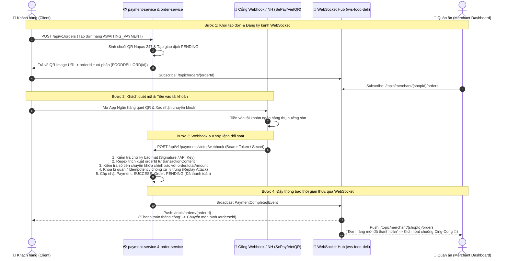

# 💳 QUY TRÌNH THANH TOÁN VIETQR & ĐẨY SỰ KIỆN REALTIME WEBSOCKET

> **Phân hệ:** `payment-service` $\longleftrightarrow$ `order-service` $\longleftrightarrow$ `chat-notification-service` (WebSocket Hub)  
> **Cơ chế:** Quét mã VietQR (Napas 247) động $\rightarrow$ Webhook biến động số dư (SePay / VietQR) $\rightarrow$ Khớp lệnh đối soát $\rightarrow$ Push STOMP Realtime.

---

## 🗺️ 1. SƠ ĐỒ TUẦN TỰ (SEQUENCE DIAGRAM)



---

## 📝 2. CHI TIẾT TỪNG BƯỚC THỰC THI (STEP-BY-STEP SPECIFICATIONS)

### Bước 1: Khách hàng Đặt đơn & Lấy mã VietQR động
* **Hành động:** Khách hàng tại màn hình Checkout chọn phương thức **"Chuyển khoản VietQR (Napas 247)"** và bấm **"Thanh toán ngay"**.
* **API thực thi:**
  * `POST /api/v1/orders`: Tạo đơn hàng lưu vào MySQL với trạng thái ban đầu `status = 'AWAITING_PAYMENT'`.
  * `POST /api/v1/payments/sepay/generate` (hoặc `/vietqr/generate`): Tạo bản ghi thanh toán trong bảng `payments` với trạng thái `PENDING`.
* **Payload SePay / VietQR trả về cho Client:**
  * `qrCodeUrl`: URL ảnh QR chuẩn SePay Napas 247 (ví dụ: `https://qr.sepay.vn/img?bank=MBBank&acc=0987654321&template=compact2&amount=154000&des=FOODDELI%20ORD123`).
  * `accountNo`: Số tài khoản thụ hưởng của hệ thống sàn.
  * `accountName`: Tên chủ tài khoản ngân hàng thụ hưởng.
  * `bankBin`: Mã định danh ngân hàng (BIN, ví dụ MBBank là `970422`).
  * `amount`: Số tiền thanh toán chính xác (ví dụ: `154000`).
  * `paymentContent`: Cú pháp nội dung chuyển khoản định danh bắt buộc: `FOODDELI ORD{orderId}` (ví dụ: `FOODDELI ORD123`).
  * `expiresAt`: Thời gian hết hạn quét mã (15 phút).
* **Đăng ký WebSocket phía Client:** Giao diện Client tự động đăng ký lắng nghe (Subscribe) tại kênh riêng của đơn hàng:
  ```stomp
  SUBSCRIBE
  destination: /topic/orders/{orderId}
  ```

---

### Bước 2: Khách quét QR trên App Ngân hàng
* Khách dùng ứng dụng ngân hàng di động bất kỳ (Vietcombank, MBBank, Techcombank, BIDV, VPBank, MoMo...) quét mã QR trên màn hình.
* Ứng dụng ngân hàng tự động điền sẵn 100% dữ liệu: Số tài khoản, Ngân hàng, Số tiền và **Nội dung chuyển khoản (`FOODDELI ORD123`)**. Khách bấm xác nhận chuyển tiền.
* Tiền được chuyển qua mạng Napas 247 và nổi số dư ngay lập tức tại tài khoản ngân hàng thụ hưởng của sàn.

---

### Bước 3: Webhook Thông Báo Biến Động Số Dư
* Ngay khi tài khoản nhận được tiền, cổng dịch vụ kết nối ngân hàng (SePay / VietQR Webhook) gửi một HTTP POST request đến Backend API Gateway:
* **API Endpoint Webhook:** `POST /api/v1/payments/sepay/webhook` (hoặc `/vietqr/webhook`)
* **Xác thực bảo mật:** Header `Authorization: Apikey <SECRET_TOKEN>` hoặc chữ ký số xác thực HMAC.
* **Payload Webhook mẫu:**
  ```json
  {
    "id": 982143,
    "gateway": "MBBank",
    "transactionDate": "2026-11-07 01:10:00",
    "accountNumber": "0987654321",
    "subAccount": null,
    "transferType": "in",
    "transferAmount": 154000,
    "accumulated": 15400000,
    "code": null,
    "transactionContent": "ND: CHUYEN TIEN FOODDELI ORD123 MA GD 87219",
    "referenceCode": "FT261107123"
  }
  ```

---

### Bước 4: Kiểm tra, Đối Soát & Cập Nhật Database
Backend `payment-service` thực hiện chuỗi quy trình xác thực nghiệp vụ:
1. **Idempotency Check (Chống trùng lặp):** Kiểm tra `referenceCode` trong bảng `payment_transactions`. Nếu giao dịch đã tồn tại thì dừng lại và trả về HTTP 200 (tránh xử lý lặp do cơ chế retry của Webhook).
2. **Regex Parsing (Trích xuất mã đơn):** Tìm mã đơn hàng từ nội dung chuyển khoản `transactionContent`:
   ```regex
   FOODDELI\s+ORD(\d+)
   ```
3. **Đối chiếu số tiền:** So sánh `transferAmount` trong Webhook với số tiền đơn hàng `payment.amount`.
   * **Nếu khớp số tiền:** Hợp lệ $\rightarrow$ Tiến hành hoàn tất thanh toán.
   * **Nếu sai lệch:** Ghi nhận transaction trạng thái `AMOUNT_MISMATCH` để kế toán rà soát thủ công.
4. **Cập nhật dữ liệu (ACID Transaction):**
   * Đổi trạng thái `payments`: `PENDING` $\rightarrow$ `PAID`.
   * Ghi log giao dịch vào `payment_transactions` (`status = 'SUCCESS'`).
   * Gọi OpenFeign Client sang `order-service`: Cập nhật trạng thái đơn hàng từ `AWAITING_PAYMENT` $\rightarrow$ `PENDING` (chờ quán xác nhận làm món).

---

### Bước 5 & 6: Phát Tán Thông Báo Thời Gian Thực (WebSocket STOMP)
Backend kích hoạt `PaymentCompletedEvent` đẩy thông điệp qua WebSocket Hub (`/ws-food-deli`):

1. **Thông báo cho Khách hàng:**
   * **Kênh đích:** `/topic/orders/{orderId}` (ví dụ: `/topic/orders/123`)
   * **Nội dung thông điệp:**
     ```json
     {
       "event": "PAYMENT_SUCCESS",
       "orderId": 123,
       "status": "PAID",
       "message": "Thanh toán VietQR thành công! Quán đang nhận đơn.",
       "timestamp": "2026-11-07T01:10:02Z"
     }
     ```
   * **Phản hồi giao diện:** Modal quét mã lập tức hiển thị hiệu ứng thành công màu xanh lá $\rightarrow$ Tự động điều hướng khách sang trang theo dõi đơn hàng `/orders/123`.

2. **Chuông báo cho Đối tác Quán ăn (Merchant Dashboard):**
   * **Kênh đích:** `/topic/merchant/{shopId}/orders`
   * **Nội dung thông điệp:**
     ```json
     {
       "event": "ORDER_CREATED",
       "orderId": 123,
       "restaurantId": 1,
       "orderStatus": "PENDING",
       "paymentMethod": "VIETQR",
       "paymentStatus": "PAID",
       "totalAmount": 154000,
       "createdAt": "2026-11-07T01:10:02Z"
     }
     ```
   * **Phản hồi giao diện Quán ăn:** Merchant Dashboard tự động phát âm thanh **chuông reo "ding-dong" 🔔**, hiển thị thông báo popup đơn mới và đưa đơn vào tab **"Đơn mới (PENDING)"** để chủ quán bấm nhận món (`CONFIRMED`).

---

## 🛡️ 3. CƠ CHẾ DỰ PHÒNG & ĐỘ TIN CẬY (FALLBACK & RELIABILITY)

| Kịch bản sự cố | Nguyên nhân | Biện pháp giải quyết |
| :--- | :--- | :--- |
| **Mất kết nối WebSocket tạm thời** | Trình duyệt rớt mạng hoặc Gateway STOMP timeout. | Phía Client chạy kèm cơ chế **Polling ngầm** (`GET /api/v1/payments/orders/{orderId}/status`) mỗi 3 giây trong suốt lúc mở modal quét mã. |
| **Webhook trễ từ phía ngân hàng** | Nghẽn mạng hoặc hệ thống ngân hàng xử lý chậm. | Modal có bộ đếm thời gian (Countdown 15 phút); có nút *"Kiểm tra trạng thái"* để khách bấm tra cứu tức thì. |
| **Khách hàng xóa nhầm nội dung CK** | Khách sửa nội dung chuyển khoản trên App ngân hàng. | Hệ thống lưu lại giao dịch vào bảng `unmatched_transactions` kèm thông tin tài khoản chuyển để hỗ trợ đối chiếu thủ công. |
| **Giao dịch gửi trùng (Webhook Retry)** | Cổng Webhook gửi lại thông báo nhiều lần. | Ràng buộc khóa duy nhất `UNIQUE KEY` trên cột `referenceCode` / `idempotency_key` chống ghi trùng lặp. |
